# Karaoke Studio

Local-first web app that turns any song into karaoke: it splits the vocals from the backing track, times the lyrics down to the word, lets you fix anything on a live timeline, and exports 1080p karaoke videos.


## What's new in 2.14

- **Five looks.** The stage and the video are drawn in one of five looks, each with its own typeface, layout and motion: **Marquee** (a venue board: giant capitals that light up as they are sung), **KTV** (the karaoke-bar machine: two outlined rows over the cover art), **Songbook** (a printed lyric sheet, the light one), **Cinema** (film subtitles under a widescreen picture) and **Prompter** (a stage teleprompter: the words ahead stay bright, the words sung go dim).
- **The stage is the video.** The stage is now a frame of the video, scaled: the same lines in the same places at the same sizes at every moment of the song. Pause it and you are looking at the frame the export will draw.
- **More in every video.** An opening title card when the song has an intro, the names of a duet's parts where the singer changes, a count-in in numerals, the seconds left of a break, and a thin progress line along the bottom.
- **Your old preset.** The nine presets are retired. A preset you had chosen becomes the look nearest it, with the colours you picked. Colours are now kept per look, since one that suits Marquee's black rarely suits Songbook's paper.
- **Cloud exports need a redeploy.** The looks use new typefaces. Until the Modal app is deployed again (`modal deploy gpu/modal_app.py`), exports render on your server instead of in the cloud.

**2.13** redrew the studio as a venue marquee (black, off-white, condensed capitals and one yellow that means lit), removed the gradients, glow and rounded cards, named controls in plain words, retired the five app themes, and brought a new icon. **2.12** added whole albums: paste a "Full Album" video or upload an album as one file, pick the songs to make, and come back for more later; a like-named song by another artist no longer replaces a song's own lyrics. **2.11** added the song search: songs listed under the box as you type, with artwork, versions and 30-second previews, misspellings respelled, songs already in the library marked, and YouTube uploads under the songs; Deezer song links work like Spotify's. **2.10** took song links from SoundCloud, Bandcamp, Vimeo and the Internet Archive as well as YouTube, matched Spotify, Apple Music and TIDAL songs to a YouTube upload of the same recording, added shortcuts on the app icon and kept the screen on while a song plays, explained failures from the new sites, and (2.10.1) fixed what a review of the whole codebase found; live streams and recordings longer than an hour are refused (`MAX_SONG_MINUTES`). **2.9** added guidance for a first song: step-by-step cards in the studio, a check-up for every song, a **Fix a problem** tab in Help, failed songs that say why, and a walk through the YouTube upload after an export. See [Using Karaoke Studio](#using-karaoke-studio) and [When results are off](#when-results-are-off). **2.8** found the right lyrics more often, gave songs with two voices their parts by voice, swept Japanese and other CJK lyrics one character at a time with their romaji underneath, kept videos from going blank in long gaps and outros (cloud renders gained Japanese fonts, so redeploy the Modal app, see **Cloud GPU** below), and added splitting and merging lines. **2.7** looks lyrics up while the stems are separated, warms the cloud GPU while the audio downloads, and opens the studio while the chords and vocal range are still being detected. **2.6** added the home screen's live lyric preview and a faster first load, saved the neural aligner's listening pass (and computes it on the cloud GPU), and made updates wait for CI. Earlier releases are in [CHANGELOG.md](CHANGELOG.md) and on the [releases page](https://github.com/moseph333/karaoke-studio/releases).

## Screenshots

| | |
| :---: | :---: |
| 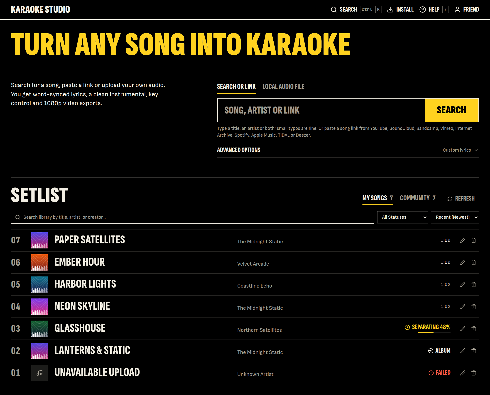 <br> Library and intake | 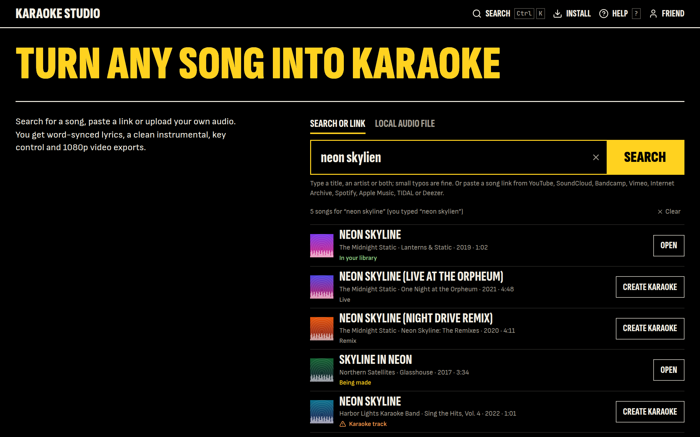 <br> Song search: a misspelled title, versions, a song already made |
| 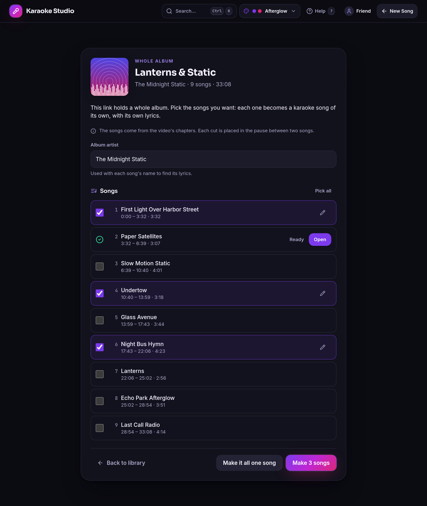 <br> A whole album: pick the songs to make | 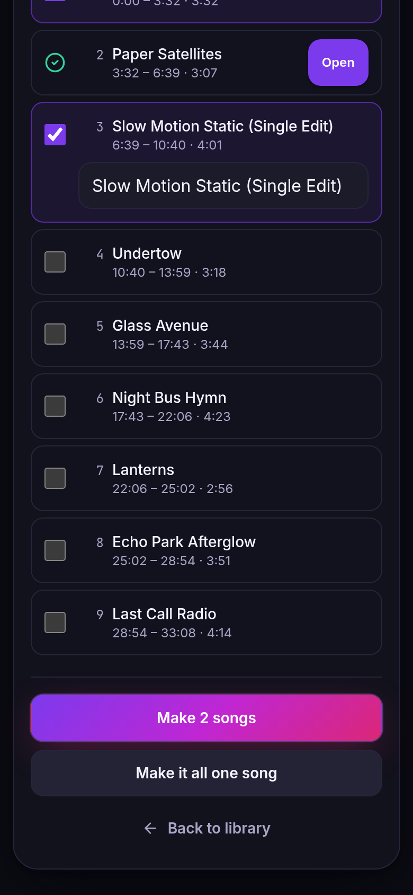 <br> Phone: a picked song renamed |
|  <br> Stem quality at intake |  <br> Re-make stems at another quality |
| 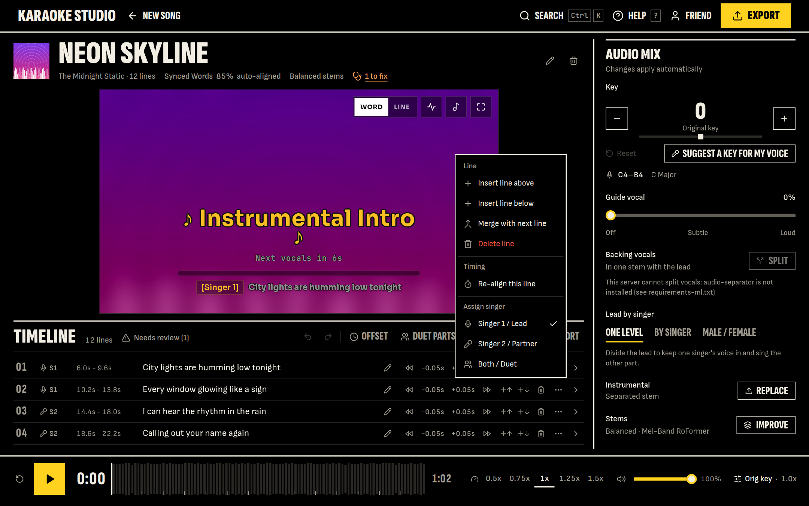 <br> Re-align one line | 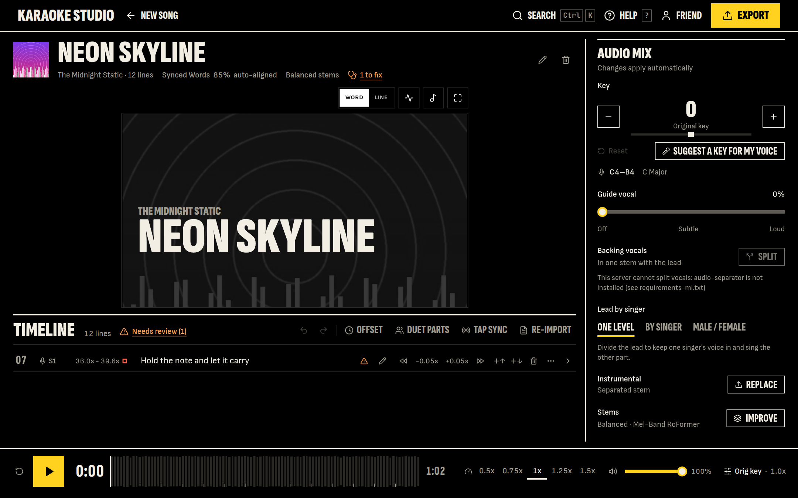 <br> Needs review |
|  <br> Command palette |  <br> Export |
| 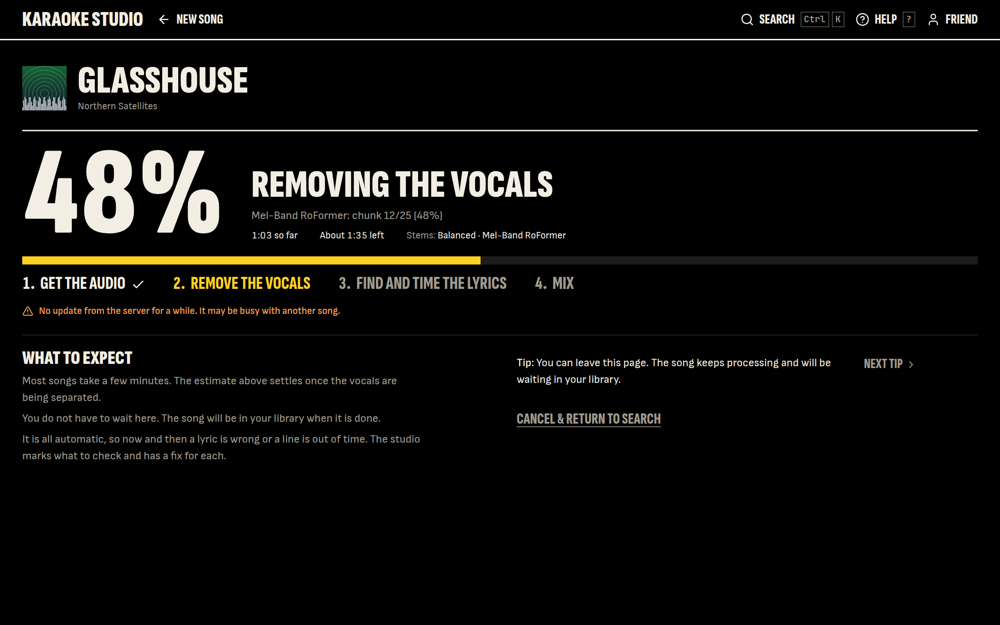 <br> Processing |  <br> Phone: stage |
| 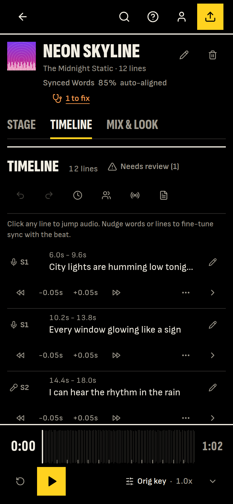 <br> Phone: timeline |  <br> First-song steps |
| 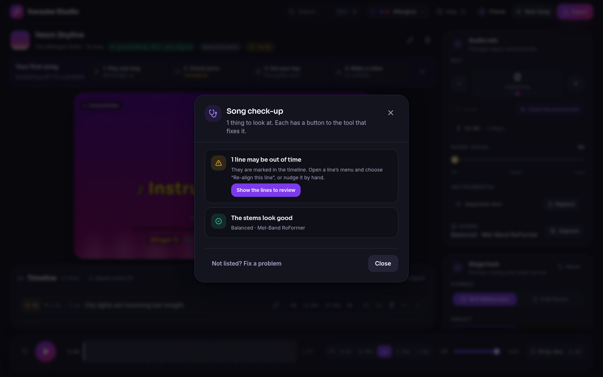 <br> Song check-up | 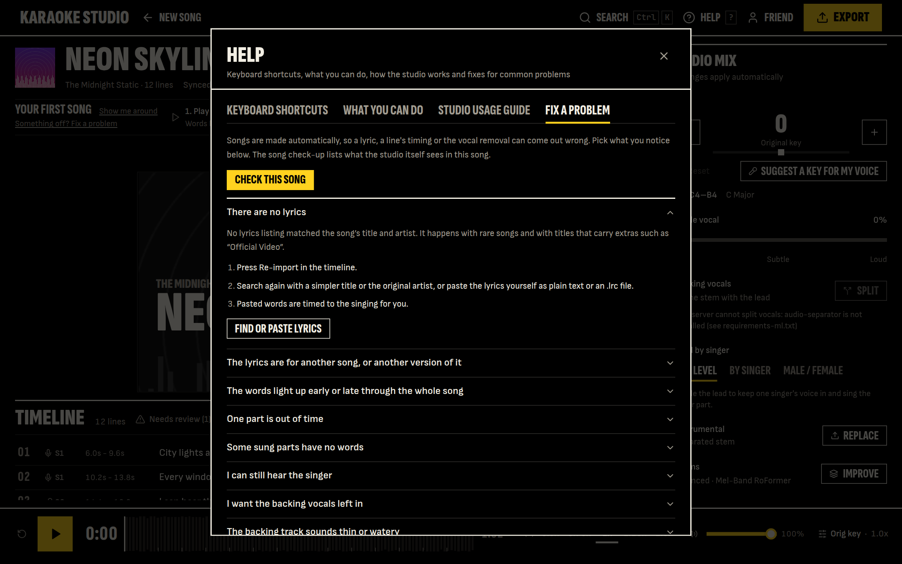 <br> Help: Fix a problem |
|  <br> A song that failed |  <br> Export: Upload to YouTube |
| 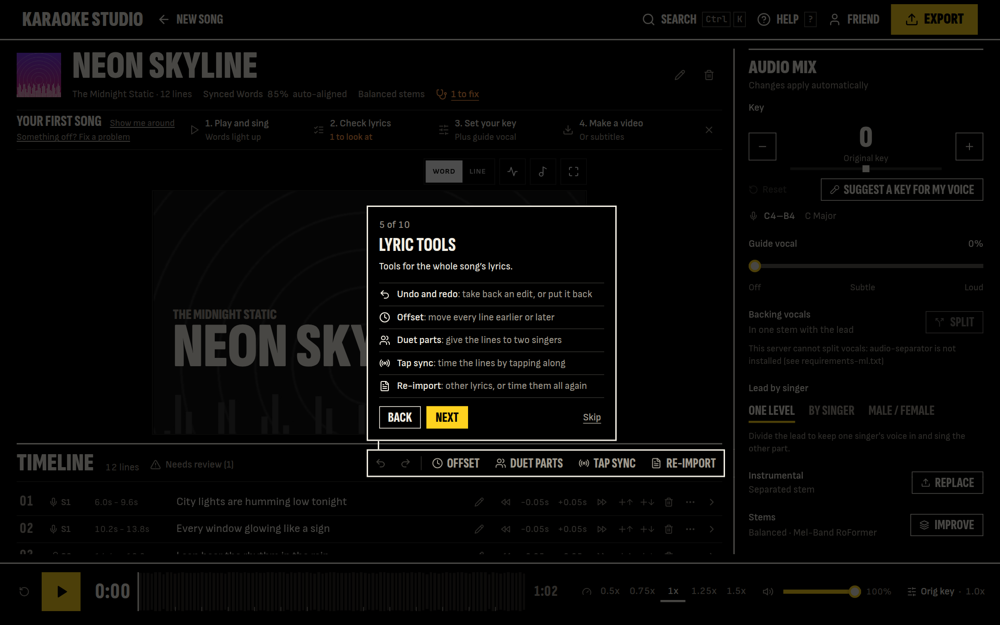 <br> The tour: a toolbar's icons, named | 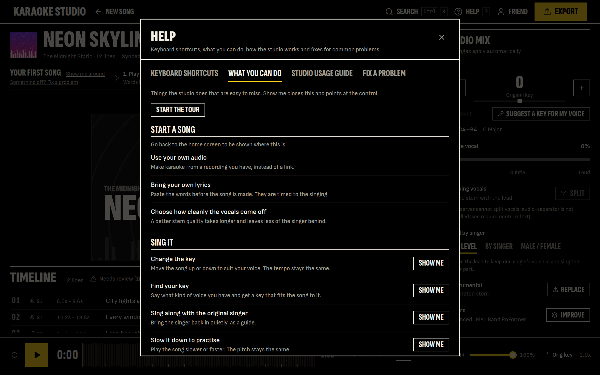 <br> Help: What you can do |

## Using Karaoke Studio

A first song, start to finish. The studio shows the same steps on a card the first time you open a finished song, and **Help** (<kbd>?</kbd>) has them under **Studio Usage Guide**.

To be shown rather than told, press **Show me around**: on that card, under "How it works" on the home screen, or in the command palette. It starts a tour that rings one part of the screen at a time and says what it does, naming the icon-only buttons on the way; on a phone it switches to the tab each part is on. Help's **What you can do** tab lists the features that are easy to miss (finding your key, re-timing one line, splitting a line, keeping a duet partner in, a moving background and more), and **Show me** beside each one points at its control.

1. **Add a song.** Type its title, its artist or both and pick it from the songs listed under the box (small typos are fine, and the artwork plays a 30-second preview). Or paste a song link (YouTube, SoundCloud, Bandcamp, Vimeo, the Internet Archive, Spotify, Apple Music, TIDAL or Deezer), or switch to **Local Audio File** and upload one. **Advanced options** holds the stem quality (Fast, Balanced, Best) and a box for your own lyrics.
2. **Wait a few minutes.** The screen shows the stage it is on and a time estimate. You can leave: the song keeps processing and waits in your library. Best quality on a CPU, and a server's first Balanced or Best song (it downloads its model once), take longer.
3. **Play and sing.** Press <kbd>Space</kbd>. The words light up as they are sung. To learn a hard part, press **Practice** next to the song's title and let that part go round.
4. **Check the lyrics.** Everything is automatic, so now and then a lyric is wrong or a line is out of time. The **check-up** button next to the song's title counts what looks off and takes you to each fix; **Needs review** above the timeline shows the lines the aligner was unsure about.
5. **Set your key.** In **Audio mix**, shift the key to your range (the tempo stays the same) and turn the guide vocal up to sing along with the original singer. The same panel can leave the backing vocals or your duet partner in while the voice you sing is removed.
6. **Make a video.** **Export** renders a 1080p karaoke video of the song as it is now: its lyrics and timing, the key and the vocals kept in Audio mix, and the look and format (16:9 or 9:16 Shorts) from Stage look. Most songs take a few minutes, and you can close the dialog while it renders. The same dialog has subtitle files, the stems and a chord sheet.

### Putting the video on YouTube

The upload itself happens on YouTube; the studio sends nothing. Once a render has finished, **Upload to YouTube** under the video in the Export dialog gives you each step:

1. **Download** the MP4, open YouTube Studio, choose **Create → Upload videos** and pick the file.
2. **Paste the title** (`Artist - Song (Karaoke Version / With Lyrics)`, shortened to fit YouTube's 100 characters).
3. **Paste the description**: the song's details, the lyrics and, when the song has three sections of ten seconds or more, timestamps that YouTube turns into chapters. Very long lyrics are cut at the end of a line so the description fits YouTube's 5,000 characters.
4. **Paste the tags.** On the upload's Details step they are under **Show more**.
5. **Check before you publish.** Start as Unlisted or Private, watch it through, then make it Public. A 9:16 video of up to three minutes is published as a Short. YouTube may recognise the song and put a copyright claim on the video (the rights holder can run ads on it or block it in some countries), so upload only songs you have the right to share.

After changing the lyrics, the key or the look, **Render Again** makes a new video; the title, description and tags follow the song.

## When results are off

**Help → Fix a problem** has these with a button to each tool. The song's **check-up** lists the ones the studio can see for itself: missing lyrics, lines that may be out of time, singing without lyrics, stems that fell back to another quality, and a background job that failed.

| What you notice | What to do |
| :--- | :--- |
| There are no lyrics | **Re-import** in the timeline: search with a simpler title or the original artist, or paste the lyrics (plain text or LRC). Pasted words are timed to the singing. |
| The lyrics are for another song or version | Fix the title or artist with the pencil next to the title, then **Re-import → Re-query LRCLIB** and apply the listing that matches what is sung. |
| The words are early or late through the whole song | **Offset** shifts every line; start with 0.1 to 0.5 s. If the gap changes through the song, re-align all lines from the Re-import dialog or the command palette. |
| One part is out of time | **Needs review** filters the unsure lines. A line's **⋯** menu has **Re-align this line**; you can also nudge it, expand it to move words, or use **Tap sync** for a long stretch. |
| Some sung parts have no words | The **Vocals without lyrics** notice above the timeline plays each stretch. Insert a line there, type the words and re-align the line. |
| I can still hear the singer | Set **Guide vocal** to Off in Audio mix. If it is still there, **Improve** re-makes the stems at Balanced or Best while the song stays playable. |
| I want the backing vocals left in | **Split** next to Backing vocals in Audio mix, then raise the Backing vocals level and leave Guide vocal at Off. |
| The backing track sounds thin or watery | **Improve** at a better quality, or **Replace** the instrumental with a real one. |
| I asked for Best and got Fast | The better model could not run (cloud GPU busy or unreachable, model not installed, too little memory). The check-up says why; **Improve** again later. |
| It is a duet, but every line has one colour | **Duet parts → By Voice**; if it finds one voice, use Alternating or set lines with the singer chip. |
| I want my duet partner's voice left in | Give each line its singer (**Duet parts**), then **Lead by singer → By singer** in Audio mix: your part down, your partner's up. For a man and a woman who sing at the same time, **Male / female** there and **Split**. |
| The song is too high or too low | Shift the key in Audio mix, or press **Suggest a key for my voice**. |
| The search does not list my song, or lists another version | Add the artist to the title, or type a line of the lyrics; small typos are fine. Tell versions apart by the album, the year, the length and the badge (Live, Remix, Edit), and tap the artwork to hear 30 seconds. **Show more songs** lists the matches after the first five. **Search YouTube uploads**, under the songs, lists videos of a recording the catalogs do not have; or paste a link, or upload the audio. |
| Processing failed | The failed song says what happened in plain words (a private, blocked or removed song, a sign-in check, a song picked from the search, or a Spotify, Apple Music, TIDAL or Deezer link, with no matching YouTube upload, a live stream or a recording longer than the server allows, a download that did not get through) and has **Try again**, which starts the song again with the lyrics you pasted for it (a song from an uploaded file is uploaded again instead). Most Vimeo videos need a sign-in the server does not have. If it fails the same way, search for the song again and pick one of the YouTube uploads listed under the songs, paste another copy of it, or download the audio yourself and upload it. A song picked from a whole album is cut out of the album again by **Try again**. |
| The video render failed, or takes very long | **Try Again** in Export. A render draws every frame, so a few minutes is normal; you can close the dialog while it runs, and a failed render keeps the previous video. |
| I don't know how to get the video onto YouTube | Render and download it, then follow **Upload to YouTube** under the finished video. See [Putting the video on YouTube](#putting-the-video-on-youtube). |
| Re-timing the lyrics or re-making the stems failed | The song keeps its previous timing and stems. Only one job runs on a song at a time: wait for it, then start again. |

## Features

### Stem separation

Pull audio from a YouTube, SoundCloud, Bandcamp, Vimeo or Internet Archive link (`yt-dlp`) or upload `.mp3`, `.wav`, `.flac`, `.m4a`, `.ogg`, `.opus` or `.aac`. A link must be one song: a track's own page, not a profile, an album page or a playlist (an Internet Archive item that holds a whole concert is refused; open one of its tracks). The same link pasted again opens the song you already made. Most Vimeo videos need a sign-in the server doesn't have, so expect those to fail. A live stream is refused, and so is a recording longer than an hour (`MAX_SONG_MINUTES`), before anything is downloaded.

**Whole albums.** A video of a whole album (a "Full Album" upload, or ten minutes or more split into three or more song-length chapters) is noticed before it downloads. The studio downloads it once, keeps it compressed (`MAX_ALBUM_MINUTES`, two hours by default) and lists its songs. The songs come from the video's chapters (YouTube also reads a track list with times from the description), else from the album's track list on Deezer or the iTunes Store when an album of that artist and name has the recording's length, else from the pauses between songs. Each cut is moved to the pause that is really there. Pick the songs you want, correct a name or the artist if needed (they find the lyrics), and each one becomes a song of its own, cut out of the album, with the album's cover. Pasting the album again, or opening its card in the library, shows the list again with the songs made so far. **Make it all one song** treats the recording as one song after all, for a long song that was taken for an album. An uploaded file of ten minutes or more is checked the same way (its own chapters, the catalog album of the title and artist you gave, or at least three songs told apart by their pauses); a file with none of these is one song as before.

**Search.** Typed words are searched as you type, in two public music catalogs that need no account or key: Deezer's search and Apple's iTunes Search. The results are songs, not videos: each recording is listed once (though both catalogs and several albums carry it) with its album, year and length, a 30-second preview, and a badge when it is a live take, a remix, an edit, a re-recording or another version. Misspellings are handled three ways: both catalogs search loosely, a misspelled search is respelled (from YouTube's search suggestions, or from the songs the typo did find) and searched both ways, and the list is ordered by how well each song's title and artist fit the words, typos allowed, so the song as released comes before live takes, remixes, covers, karaoke tracks and tribute acts unless you ask for one ("wonderwall live"). A line of the lyrics often works too. A song already in your library is marked and opens instead of being made again. Picking a song starts it like a Deezer or Apple Music link, described next, so it gets the catalog's title and artist and the upload of that very recording. **Search YouTube uploads**, under the songs, lists videos for anything the catalogs don't have; it is also what the search shows when no catalog can be reached. Each search sends the typed words from the server to Deezer, Apple and Google's suggestion service (`SONG_SEARCH_SOURCES` chooses which, and `none` keeps the search on YouTube alone), and your browser loads the artwork and previews straight from Deezer's and Apple's servers.

Spotify, Apple Music, TIDAL and Deezer can't be downloaded from, so a link to one of their songs is looked up instead: the studio reads the song's title, artist and length from the service and picks a YouTube upload of the same recording, never a cover, a live take, a remix or an upload more than 15 seconds longer or shorter. The song keeps the service's title and artist, which find the lyrics more reliably, and the song check-up names the upload that was used (with a tip when its length differs by a few seconds, which can mean another edit). If no upload matches, the song stops and says so; search for it and pick one of the YouTube uploads listed under the songs instead. Other streaming services (Amazon Music, Qobuz) aren't supported, so download the audio and upload it. The song is split into `vocals.wav` and `instrumental.wav` at the quality you pick in **Advanced options**:

| Preset | Engine | Time on CPU (4-min song) | Notes |
| :--- | :--- | :--- | :--- |
| **Fast** | Demucs `htdemucs` | about 1.5 min | Bundled. Some instrument bleed in the vocals. |
| **Balanced** *(default)* | Mel-Band RoFormer | about 6 min | Cleaner vocals, tidier backing track. Needs the ML extras. |
| **Best** | Mel-Band RoFormer + BS-RoFormer, averaged | about 25 min | Cleanest. A GPU is recommended. |

When a preset cannot run (extras not installed, weights unavailable, out of memory), separation falls back Best → Balanced → Fast and the studio says why. The Mix panel shows which model made a song's stems, and **Improve** re-makes them at another quality while the song stays playable. You can also re-time the lyrics against the new vocals or detect the chords again.

**Vocal parts: choose which voices stay in.** Removing the vocals removes every voice at once. Two things in the **Audio mix** panel decide voice by voice, for a song that is already made:

- **Backing vocals.** **Split** next to Backing vocals separates the harmonies from the lead with one more model (a Mel-Band RoFormer "karaoke" model, `SEPARATION_LEAD_MODEL`). It runs in the background like **Improve**, where Balanced and Best run (your server with the ML extras, or the cloud GPU), and takes about as long as a Balanced separation; there is no Fast equivalent, so a server that cannot run RoFormer says so on the button. Afterwards Backing vocals has its own level, from removed to fully in, next to the guide vocal, which then sets the lead alone.
- **Lead by singer.** For a song whose lines are assigned to more than one singer (**Duet parts** in the timeline), **By singer** gives each singer a level, and one for lines sung together: turn your own part down and your partner's up. It needs no model, because it follows the lyric lines: each singer's level starts just before their line and holds a second past its last word, with short fades. That also means it cannot tell two people apart while they sing at the same time; those lines follow the Sung together level. For a man and a woman who do, **Male / female** splits the lead into a stem for each voice with another model (`SEPARATION_DUET_MODEL`) and gives each its own level. How well that works depends on the song.

The levels are part of the song like its key: videos are rendered with them, a mix that follows the lyric lines is made again when you save lines that moved, and the Export dialog adds the lead, backing, male and female stems of a song that has them. Re-making a song's stems with **Improve** deletes the parts that were split from the old vocals (the job says so); split them again and the levels you had set apply again. Each split adds two WAV files the size of the vocal stem.

**Cloud GPU (optional).** On a slow CPU, Balanced and Best can run on a [Modal](https://modal.com) GPU instead: deploy `gpu/modal_app.py` with `modal deploy gpu/modal_app.py` (again after updates that change it, the RoFormer or aligner workers, `backend/requirements-ml.txt` or the fonts, as 2.8 did by adding Japanese fonts to the cloud renders and 2.14 by adding the looks' typefaces (until then exports render on your server), and as the male/female vocal split needs: until the app is deployed again that split fails on the cloud GPU, while the lead/backing split and every separation keep working), then set `SEPARATION_REMOTE=modal` and a Modal token in `.env`. The GPU runs the same RoFormer worker, progress streams back to the studio, and a 4-minute song takes about a minute on Balanced and two on Best, billed per second. The same GPU job also runs the neural lyric aligner's listening pass over the new vocals, so lyric sync on your server skips its slowest step (a few seconds of GPU time instead of minutes of CPU). If the GPU service is unreachable or no GPU is free within `SEPARATION_REMOTE_QUEUE_SEC`, the song falls back to Fast on your server.

### Lyrics and sync

- Lyrics come from LRCLIB, NetEase and `syncedlyrics`, or you paste plain text or LRC (enhanced LRC word tags are kept). A fan upload titled "Artist - Song" is searched by its artist, the cleanest of LRCLIB's versions wins, and NetEase's version is used when it writes out repeats that LRCLIB lists once. **Re-import** lists every version best first, with what looks wrong with each and which one the song uses.
- Fetched lyrics are tidied before they are timed: translation notes and "x2" markers go, lines too long to sing as one are split, all-caps lyrics become sentence case, and a Japanese (or other CJK) line's romaji in parentheses becomes a smaller row under it.
- **Neural alignment** (MMS forced alignment through torchaudio) places each word when the model is available. The **DSP aligner** (vocal energy, spectral flux and phrase snapping) is the fallback and the in-request engine. The model's listening pass over a stem is saved (`<data dir>/alignment_cache`, the 200 most recent songs, about 1.5 MB each), so re-timing lyrics or a single line later only runs the alignment.
- Every line gets a **confidence** score from how well the vocal stem supports its timing. The sync badge shows the song's average, a dot on each timeline row shows the line's, and **Needs review** filters the lines below 60%.
- The **song check-up**, the button next to the song's status badges, counts what looks off (missing lyrics, lines that may be out of time, singing without lyrics, stems that fell back and why, a failed background job) and has a button to the tool that fixes each. See [When results are off](#when-results-are-off).
- **Re-align this line** (row menu) finds where a line is really sung near its current place and applies the result as an undoable edit. Whole songs can be re-aligned in the background with the neural aligner while you keep working.
- Singing with no line to show (a hook the lyrics wrote once but the song repeats) is listed above the timeline as **Vocals without lyrics**; with the neural aligner, new songs get those repeats added as lines marked **Added repeat**.
- CJK lyrics are timed one character at a time, and the neural aligner times a line with romaji from its romaji.
- Lines you change by hand are marked as manual and keep your timing, also when the whole song is re-aligned or its stems are re-made with re-timed lyrics. Lines of two or more words that the editor only spread evenly (line-by-line tap-to-sync, new or retyped lines) still get their words placed by the aligner; a one-word line, such as an ad-lib, keeps its timing.

### Timeline editor

50-step undo and redo, live tap-to-sync (<kbd>T</kbd>), batch offsets, ±0.2 s and ±0.05 s nudges, an expandable per-word editor, splitting a line after any word and merging it with the next, inline text and chord editing, and duet parts (Singer 1, Singer 2, Both). New songs whose vocals clearly hold two voices get their parts by voice, **Duet parts → By Voice** assigns them later, and the parts can be given names in the track details, which the stage shows.

### Practice

**Practice**, next to the song's title (or <kbd>P</kbd>), swaps the timeline for what you rehearse with; the stage, the mix and the player stay, and lyric edits you have not saved are still there when you come back. The address keeps `practice=1`, so a reload or a bookmark returns to it.

- **Repeat a part.** Turn on **Repeat this part** (or press <kbd>L</kbd>) while a part plays and it goes round until you turn it off. Each pass starts two seconds before the part's first line and runs a moment past its last, and the scrubber marks the stretch in yellow. Jump to another part and that one repeats instead.
- **Pick the part.** The panel lists the song's parts by their first words. A song has no verse or chorus markers, so the parts are split where the singing pauses, and a long run is cut at its longest breath so no part has more than eight lines. Press a part to repeat it from its start.
- **Or pick the lines.** **Repeat from line** and **Repeat to line** set a stretch of your own, down to a single line. It stays where you put it.
- **Bring the singer in and out.** **Original singer** (or <kbd>O</kbd>) switches the original vocal on and off at once, with a level of its own: listen to how a line goes, then switch off and sing it. Unlike the guide vocal in Audio mix it needs no new mix, because the studio plays the singer's track beside the song instead of asking the server to blend it in, and it follows your key and speed. If the mix itself already has the guide vocal in it, the panel says so and offers to take it out.
- **See if you are in tune.** **See your pitch** asks for your microphone and draws a lane under the stage: the song's melody in grey, running past a line that marks now, and the note you are singing against it, yellow while you are on the note. The right note in another octave counts (a low voice singing a high song an octave down is in tune), within a semitone, and a little early or late. The lane follows your key and speed and goes with the stage into fullscreen. What you sing is worked out in your browser and goes nowhere: it is not recorded and not sent to the server. Wear headphones, or the microphone hears the song as well as you. Browsers only give a page a microphone over `https` (or on `localhost`), so this needs the studio on a secure address. The melody is read from the song's vocals the first time you ask (a few seconds); a duet or a song with loud backing vocals gives a melody that jumps between the voices, which splitting the vocals into lead and backing (Audio mix) fixes, since the melody is then read from the lead alone.
- **A score for each pass.** With your pitch showing, the panel says how much of the last pass was in tune ("Last pass: 72% in tune, lines 4 to 8. Best: 80%.") and each part's row shows its latest. A pass ends when a repeating part goes round or when you pause, so a part on repeat is scored every time through. The score is the share of the melody's sung moments you matched, by the same rule as the yellow line; a line counts only when the pass went through most of it, and a line with almost nothing sung in it (a shout, a spoken word) is not scored. Scores stay in your browser: the best for a whole song is remembered there, and nothing is saved on the server.
- Slow the part down with the player's speed (0.5× to 1.5×, the pitch stays), and set your key in Audio mix: both work as they do outside practice.

### Stage, look and export

- **Five looks**, which set how the stage and the video are drawn:

  | Look | What it is | How lyrics sit |
  |---|---|---|
  | **Marquee** (the default) | A venue board in the app's own black, off-white and yellow | The line being sung in capitals, as large as the frame allows, with the next line under it |
  | **KTV** | The karaoke-bar machine: rounded heavy type with an outline, over blurred cover art. Draws Japanese in its own typeface | Two rows, the first flush left and the second flush right, taken in turn |
  | **Songbook** | A printed lyric sheet: black type on paper, sung words in red. The light look | A column that moves up, with part names in the margin |
  | **Cinema** | Film subtitles: the picture in widescreen, the words in the black under it | One centred line with the next under it |
  | **Prompter** | A stage teleprompter. Words still to sing stay bright; words sung go dim | A column that moves up past a marker at the reading line |

- **The stage is a frame of the video.** Both place every line by the same rule, so what the stage shows at a moment is what the export draws then; pause to check a frame. On a phone the frame is small: use fullscreen (<kbd>F</kbd>) to read it.
- Word-sweep or line-by-line highlighting, backing vocals and ad-libs (words in parentheses) drawn smaller, Japanese and other CJK lyrics swept per character with their romaji underneath, a beat visualizer (<kbd>V</kbd>), a transposing chord bar (<kbd>C</kbd>) and a fullscreen TV stage (<kbd>F</kbd>).
- **A second screen.** The stage's toolbar opens the stage in a window of its own: drag it to a TV or projector and press <kbd>F</kbd> in it, and the lyrics run there while the timeline, the mix and the player stay on your screen. It follows the song, the look and your edits as you make them, and Space and the arrow keys in it play, pause and seek. Chrome and Edge can put the window on the other screen for you when you allow it. Both windows are in one browser on one computer; the spectrum background shows as cover art there.
- Every look draws the same parts in its own type: an opening title card (when the first line starts six seconds in or later), a count-in over the last three seconds before a line that follows a break, the seconds left of a break, the name of a duet's part where the singer changes, a progress line along the bottom, and an end card with the title and artist.
- Your own sung and unsung colours, Singer 2 and Both colours, and lyric size on top of a look. Colours are kept per look. Stage settings are remembered, and a preset chosen before the looks becomes the look nearest it. The app around the stage has one look: black, off-white and one yellow.
- Backgrounds: the song's **cover art**, still or **drifting** in a slow pan, **aurora** (soft orbs in the look's colours), a **spectrum** that rises with the music, a **plain** colour, or your own image or looping video. Each look treats the cover art its own way (Marquee grey and dark, KTV blurred, Songbook a faint wash, Cinema sharp in its frame, Prompter nearly black) and dims or washes an upload so its lyrics stay readable. Your upload is remembered by your browser and shown behind every song; **Replace** or **Remove** deletes the old file from the server (a video still rendering with it finishes first). The stage draws each one the way the video does: cover art is the export's own image, and moving backgrounds follow the song.
- **Song loop (optional).** With `SONG_LOOP_REMOTE=modal`, **Make a loop** in the Stage look panel draws a looping background video for the song on a cloud GPU. A small language model reads the lyrics and writes one scene (scenery only: no faces and no lettering, so nothing competes with the lyrics), a video model draws a few seconds of it, and the clip is faded into its own start so it repeats without a jump. The scene is shown as text: change the words and make it again, type your own, or clear them for a new scene from the lyrics. A loop is made **Best** (Wan 2.2, 7 to 8 minutes, measured on an L40S and a 40 GB A100) or **Fast** (LTX-Video, about 2 minutes, for trying a scene out: its view may drift, which can show as a faint double image where the loop repeats). It runs in the background while the song stays playable, one loop at a time, and each one is billed as GPU seconds; the first loop with each model also downloads it. A song keeps one loop; **Song loop** then joins the backgrounds, shown under each look's treatment of an upload on the stage and in exports, and songs without one show their cover art.
- Key shift (−12 to +12 semitones) and speed (0.5× to 1.5×), a 0–50% guide vocal, levels for the backing vocals and for each singer of a duet (see **Vocal parts** under [Stem separation](#stem-separation)), and **Suggest a key for my voice**, which fits a song's vocal range to your voice. Final renders shift pitch with Rubber Band at high quality, keeping the guide vocal's formants.
- Exports: 1080p60 MP4 (16:9 or 9:16 Shorts) in the chosen look, with the lyric sweep drawn for every frame and long lines sized and broken to fit, `.lrc` and `.ass` subtitles (the `.ass` file is laid out for the look's typeface, which it names in its first lines), WAV stems (with the vocal parts of a song that has been split), chord and lyric sheets, and a YouTube metadata kit. **Render Again** makes a new video after you change the lyrics, key or look, and **Try Again** retries a failed render. A failed or cancelled render keeps the previous video, and the 16:9 and 9:16 videos are kept side by side, so rendering one format never replaces the other.
- **Cloud export (optional).** With `RENDER_REMOTE=modal` (same Modal deployment and token as the cloud GPU), MP4s render on a 16-core Modal CPU: about 1¼ minutes for a 3-minute song, around a cent each. Opening the Export dialog starts a cloud CPU in the background, so Modal finds one while you choose the options, and it stays ready for 2 minutes after each export. While the export waits for a CPU, the studio counts the seconds. If it is unavailable or fails, the export renders on your server.

### A karaoke night

**Run a show** (on the home screen, or in the command palette) opens a host screen for running karaoke with one computer and two screens: yours has the queue, and the TV or projector has the stage window.

- **Add a singer**: type their name, then pick their song. **Karaoke videos** searches YouTube for karaoke uploads of the song (a pasted YouTube link works too); **Library** lists the songs you have made here.
- **Start the song** calls the first singer in the queue. Between singers the TV shows who is up next with their song, and the name of the night when nobody is waiting. A song that ends is marked sung and the next singer is called; "Again" puts a singer back in the queue.
- **Take turns** (the switch beside the queue, on to begin with) decides where a song joins the queue: behind everyone still waiting for a turn, and ahead of the next songs of singers who will already have had one. So a singer who puts three songs in sings one each time round, a singer who has just sung and goes "Again" waits for the others, and a newcomer is not left behind somebody's second song; the host screen says where each singer went. A singer is told apart by their name, whatever its capitals. It moves nobody who is already waiting, and with it off a song joins the end of the queue.
- **Change the order** by dragging a singer's row to another place in the queue (on a touchscreen, by the grip at its left), or with the row's arrows, one place at a time. Escape puts a row you are dragging back.
- **A library song** plays with its word-timed lyrics, in the look you chose in the studio. **A YouTube video** plays on the stage window in YouTube's own player, started, paused and stopped from your screen. Your screen shows the same video without sound, so you see what the room sees; it is a second playing that follows the first, and can be a moment out of step.
- **Videos YouTube will not embed.** Some uploaders, the largest karaoke channels among them, only let their videos play on youtube.com. The server finds this out when the video is queued, fetches a copy (720p at most) and plays that on the stage window instead. Copies are kept up to `SHOW_VIDEO_CACHE_GB` (3 GB), the least recently used going first; `SHOW_VIDEO_DOWNLOADS=0` turns this off, and those videos then cannot be played.
- **A song nobody can find.** When a song has no karaoke video and is not in the library, **Request it** (under the search results in Add a singer) puts it on a request list kept on the server, with who asked and the name of the night. The host screen shows the list. The studio's home screen shows it too, under **Requests**: **Find it** searches for the song so you can make it, which takes it off the list, or remove a request you will not make. A song asked for again is counted, not listed twice, and the list holds 200 songs.
- **If the stage window is closed or reloaded during a video**, open it again from the host screen: the video goes on from where it was.
- The queue and the name of the night are kept in the browser, so a reload does not lose them. While the host screen reloads, the TV keeps the name of the night up. Click the stage window once after opening it (the prompt to fill the screen is that click): browsers start sound only in a window that has been clicked.
- YouTube shows its adverts in its player unless the browser is signed in to an account without them.
- **Signing in for the night.** A studio sign-in lasts seven days. If yours would end within the next twelve hours, the host screen asks for the passphrase when you open it, before anybody is singing; **Carry on without** skips that.
- **When the sign-in ends during the night**, the host screen stays open and what is playing carries on. A line across the top says so; **Sign in again** there when you have a moment, and a song that would not load in between is loaded then. **Try again** beside a song that failed does the same for one song.
- **Handing it to a venue.** Set `SHOW_PASSWORD` on the server and give the venue that passphrase and the address ending in `/?show=1`. It opens the host screen and nothing else: the songs can be queued and played, not edited, renamed, deleted or exported, and the studio and the server's settings stay shut. The venue can ask for songs it could not find, and cannot take a request off the list. The venue's sign-in renews itself whenever the host screen is opened or left open, so a venue with a show every week types the passphrase once; it is asked again after a week without a show. Changing `SHOW_PASSWORD` signs the venue out.

### On your phone

- **Install it as an app.** On Android (Chrome), tap **Install** in the header on the library screen, or pick **Install app** from the command palette or the browser menu. On iPhone and iPad, open the studio in Safari, tap **Share**, then **Add to Home Screen**. Installing needs the studio served over HTTPS, and the installed app keeps its own sign-in, so you enter the passphrase once more there.
- **Share songs to it (Android).** Share a video from the YouTube app, or a song from SoundCloud, Bandcamp, Spotify, Apple Music, TIDAL or Deezer, to Karaoke Studio and it opens with the link in the search box; tap **Go** to start. A share from another app puts the shared words, such as the song's name, in the box and lists the songs they find.
- **Shortcuts on the icon.** Long-press the app icon (or right-click it in the taskbar or dock on a computer) for **New song**, **Upload audio** and **Continue last song**, which reopens the song this device had open last.
- **Feels like an app.** Back returns from a song to the library, the layout keeps clear of the notch and rounded corners, pull-to-refresh can't reload you mid-edit, the screen stays on while a song plays, the bar under Android's gesture pill is black like the app (Chrome 153 or newer), and while your server is down or restarting the app shows a "Can't reach your studio" screen that reloads by itself when the server is back.
- **Updates.** A **Reload** toast appears once the server runs a newer build. Where the server applies its own updates (`SELF_UPDATE=1`), an **Update now** toast also appears as soon as GitHub has a newer version.

## Quick start

### One-command local launch

```bash
./run.sh
```

Checks FFmpeg, creates the Python environment, installs dependencies (CPU PyTorch by default), builds the frontend if needed, starts the server on port `8000` and opens your browser. Set `INSTALL_ML_EXTRAS=1` to also install the RoFormer extras for Balanced and Best, and `TORCH_INDEX_URL` to pick another PyTorch build (for example CUDA):

```bash
INSTALL_ML_EXTRAS=1 ./run.sh
```

### Docker Compose

```bash
docker compose up -d
```

The image includes the ML extras (build with `--build-arg INSTALL_ML_EXTRAS=0` for a smaller, Fast-only image). Model weights live in the `karaoke-models` volume, so they download once and survive rebuilds. To expose the app through a Cloudflare Tunnel, set `CLOUDFLARE_TUNNEL_TOKEN` in `.env` and run:

```bash
docker compose --profile tunnel up -d
```

To update a shared instance without cutting off anyone's song import or render, run `scripts/update_when_idle.sh` from the checkout (from cron or a systemd timer, say) instead of `git pull && docker compose up -d --build`. It builds the new image while the old container keeps serving, then pauses new songs, uploads, renders and re-made stems (everyone sees a notice; editing and playback keep working), waits until the running jobs finish or `UPDATE_DRAIN_MAX_SEC` passes, and only then recreates the container. If the build or the restart fails, the old container keeps serving and the next run tries again, until a fix is pushed. `--force` rebuilds without a new commit.

When the checkout's origin is on GitHub, the script moves to a new commit only once that commit's CI run has passed. A failed run keeps the install on the version it is running, and a run that is still going is waited for (`UPDATE_CI_WAIT_SEC`), then left for the next call. A commit whose run was seen failed or still going stays held back on later calls that cannot read a result. Otherwise, if there is no result to read (GitHub's API cannot be reached, or the commit has no CI run), the update goes ahead and the log says so. `UPDATE_REQUIRE_CI=0` turns the check off; `--force` does not.

### Manual development setup

```bash
# Backend (port 8000)
python3 -m venv venv
source venv/bin/activate
pip install --extra-index-url https://download.pytorch.org/whl/cpu -r backend/requirements.txt
pip install --extra-index-url https://download.pytorch.org/whl/cpu -r backend/requirements-ml.txt  # optional
uvicorn backend.main:app --host 0.0.0.0 --port 8000 --reload

# Frontend (proxies API requests to localhost:8000)
cd frontend
npm install
npm run dev
```

## Models and licences

Nothing is downloaded until it is first needed. Downloads go to persistent model folders (Docker: the `/models` volume).

| Model | Used for | Size | Licence | Folder |
| :--- | :--- | :--- | :--- | :--- |
| Demucs `htdemucs` | Fast | about 80 MB | MIT | `TORCH_HOME` |
| Mel-Band RoFormer | Balanced, Best | about 0.9 GB | third-party, see the model card | `AUDIO_SEPARATOR_MODEL_DIR` |
| BS-RoFormer | Best | about 0.6 GB | third-party, see the model card | `AUDIO_SEPARATOR_MODEL_DIR` |
| Mel-Band RoFormer Karaoke | splitting lead and backing vocals, on request | see the model card | third-party, see the model card | `AUDIO_SEPARATOR_MODEL_DIR` |
| BS-RoFormer Male-Female | splitting a male and a female voice, on request | see the model card | third-party, see the model card | `AUDIO_SEPARATOR_MODEL_DIR` |
| MMS forced aligner | neural lyric alignment | about 1.2 GB | **CC-BY-NC 4.0 (non-commercial)** | `ALIGNMENT_MODEL_DIR` |
| Qwen3 4B | writing a song loop's scene from the lyrics, on the cloud GPU only | about 8 GB | Apache 2.0 | Modal volume `karaoke-models` |
| Wan 2.2 TI2V 5B | drawing a song loop, on the cloud GPU only | tens of GB | Apache 2.0 | Modal volume `karaoke-models` |
| LTX-Video 0.9.7 distilled | drawing a song loop when `SONG_LOOP_MODEL=ltx`, on the cloud GPU only | tens of GB | **LTXV Open Weights License (free under $10M yearly revenue, not open source)** | Modal volume `karaoke-models` |

- Review the model licences before any commercial use. The MMS aligner is for non-commercial use only. Set `ALIGNMENT_ENGINE=dsp` to never use it.
- The song loop models never run on your server and are never downloaded to it: they load into the Modal volume the first time a loop is made with them, which makes that first loop slow.
- To prefetch everything (for example while building an image, or for an offline server), run:

  ```bash
  python -m backend.tools.fetch_models --separation all --vocal-parts all --alignment
  ```

  Then set `SEPARATION_ALLOW_DOWNLOAD=0` and `ALIGNMENT_ALLOW_DOWNLOAD=0` so the server never downloads at run time.
- `GET /api/capabilities` reports what the server can run right now and why not; the intake picker, the vocal split buttons and the re-align dialogs use it.

## Keyboard shortcuts

Shortcuts are ignored while you type in a field or while a dialog is open.

| Key | Action |
| :--- | :--- |
| <kbd>Space</kbd> | Play / pause |
| <kbd>←</kbd> / <kbd>→</kbd> | Seek 5 seconds |
| <kbd>Shift</kbd>+<kbd>←</kbd> / <kbd>→</kbd> | Seek 1 second |
| <kbd>Alt</kbd>+<kbd>←</kbd> / <kbd>→</kbd> | Seek 15 seconds |
| <kbd>[</kbd> / <kbd>]</kbd> | Previous / next lyric line |
| <kbd>R</kbd> | Replay the current line |
| <kbd>M</kbd> | Mute / unmute |
| <kbd>P</kbd> | Practice on / off |
| <kbd>L</kbd> | In practice: repeat the part being sung |
| <kbd>O</kbd> | In practice: original singer on / off |
| <kbd>F</kbd> | Fullscreen stage |
| <kbd>V</kbd> | Beat visualizer |
| <kbd>C</kbd> | Chord bar |
| <kbd>T</kbd> | Tap-to-sync stamp |
| <kbd>Ctrl</kbd>/<kbd>⌘</kbd>+<kbd>Z</kbd>, <kbd>Ctrl</kbd>/<kbd>⌘</kbd>+<kbd>Y</kbd> | Undo / redo lyric or chord edits |
| <kbd>Ctrl</kbd>/<kbd>⌘</kbd>+<kbd>K</kbd> | Command palette: every action, song and lyric line |
| <kbd>?</kbd> | Help and usage guide |
| Media keys | Play, pause, previous / next line, seek (MediaSession) |

In the song search on the home screen, <kbd>Enter</kbd> searches at once, <kbd>↓</kbd> moves from the box into the results and <kbd>↑</kbd> / <kbd>↓</kbd> between them, <kbd>Enter</kbd> starts the focused song, and <kbd>Esc</kbd> returns to the box (pressed there, it dismisses the results).

## Configuration

Copy `.env.example` to `.env`; it documents every setting.

```bash
cp .env.example .env
```

| Variable | Default | Purpose |
| :--- | :--- | :--- |
| `PORT` | `8000` | Port for the web UI and API |
| `APP_PASSWORD` | *(empty)* | Optional shared passphrase (`HttpOnly` cookie session). Leave blank for open local access. |
| `ADMIN_PASSWORD` | *(empty)* | The owner's passphrase for the [Server settings](#server-settings) page, asked for on top of `APP_PASSWORD`. Empty turns the page off: no server setting can be changed from the studio. |
| `SHOW_PASSWORD` | *(empty)* | A passphrase that only runs [a karaoke night](#a-karaoke-night): it opens the host screen, reads the songs and plays them, and can change or delete nothing. For a venue's host, in place of `APP_PASSWORD`. Empty: the host screen takes `APP_PASSWORD` only. |
| `SESSION_SECRET` | *(empty)* | Server secret session tokens are signed with, together with the passphrase. Empty uses a random secret the server creates in `<data dir>/.session_secret` on first sign-in. Changing either signs everyone out. |
| `SELF_UPDATE` | *(off)* | `1` where a host service applies updates written to `<data dir>/.update_requested` (as on the homelab). The studio then shows an **Update now** toast when GitHub's `main` is ahead of the running build. |
| `UPDATE_DRAIN_MAX_SEC` | `2700` | How long `scripts/update_when_idle.sh` waits for running jobs before it restarts the server anyway (jobs still running then are interrupted). New jobs stay paused while it waits. |
| `UPDATE_REQUIRE_CI` | `1` | `scripts/update_when_idle.sh` moves to a new commit only once its CI run on GitHub has passed. `0` updates without asking. |
| `UPDATE_CI_WAIT_SEC` | `900` | How long the script waits for a CI run that is still going before it leaves the update for its next call. |
| `UPDATE_CI_TOKEN` | *(empty)* | GitHub token the script reads the CI result with. Only a private repository needs one (read access to Actions); without it GitHub answers 404 and the update goes ahead unchecked. |
| `LOGIN_RATE_LIMIT_MAX_ATTEMPTS` / `LOGIN_RATE_LIMIT_WINDOW_SECONDS` | `5` / `60.0` | Wrong passphrases allowed per IP and window, at login or in a header or cookie on any route (each distinct value counts once per window), before HTTP `429`. A client over the limit gets `429` even with valid credentials. |
| `FORWARDED_TRUSTED_HOPS` | `1` | Reverse proxies in front of the app that append to `X-Forwarded-For`; the rate limit keys on the entry this many places from the end. `2` for cloudflared in front of Nginx Proxy Manager, but only if Nginx Proxy Manager gets traffic from cloudflared alone: a client that reaches it directly (on the LAN, say) can pick its own rate-limit key with a forged header, so use `1` there. `0` to ignore the header and use the socket address. |
| `MAX_JSON_BODY_MB` | `16` | Largest request body outside the upload routes (which keep their own limits plus 1 MB); larger bodies get HTTP `413` before they are read. |
| `ALLOWED_HOSTS` | *(empty)* | Comma-separated host names the server answers to (`*.example.com` matches subdomains); other `Host` headers get HTTP `400`. Empty answers any host. Set it on an install without a passphrase to stop DNS rebinding, where a website points its own name at the server. `localhost`, `127.0.0.1` and `::1` always work. |
| `MAX_CONCURRENT_JOBS` | `2` | Separations, re-separations, re-alignments and renders running at once |
| `PREVIEW_AUDIO_FORMAT` | `wav` | What the studio streams: the WAV master, or `aac` for a 160 kbps `.m4a` copy (about 5 MB instead of 40 MB for a 4-minute song; each new mix takes a few seconds longer). Exports and videos always use the WAV. |
| `MIX_CACHE_PER_SONG` | `6` | Key and guide mixes kept per song (each about 40 MB for a 4-minute song, plus its `.m4a` copy); the least recently used are deleted first and the current mix is always kept. The vocals practice plays at a changed key count as mixes. Applied after each remix and re-separation, and to every song when the server starts. `0` keeps every mix. |
| `KARAOKE_DATA_DIR` | `./workspace_data` | Audio, stems, renders and `projects.json` |
| `MAX_SONG_MINUTES` | `60` | The longest recording a pasted link may download, in minutes. A longer video is refused before anything is downloaded, as is a live stream; `0` lifts the length limit. Uploaded files have their own size limit. |
| `MAX_ALBUM_MINUTES` | `120` | The longest whole-album recording a pasted link may download to pick songs from, in minutes (kept compressed; each picked song is cut out of it). A longer album is refused before anything is downloaded; `0` lifts the limit. |
| `SONG_SEARCH_SOURCES` | `deezer,itunes,suggest` | The services the song search asks, comma-separated: `deezer` and `itunes` are the music catalogs the songs come from, `suggest` is YouTube's search suggestions, used to respell a misspelled search. Each search sends the typed words to the ones listed. `none` turns the catalog search off: the studio then lists YouTube uploads, as it does when no catalog answers. |
| `SHOW_VIDEO_DOWNLOADS` | `1` | In a show, a YouTube karaoke video whose uploader does not allow embedding is downloaded and played from the server's copy. `0` turns that off: such videos then cannot be played. |
| `SHOW_VIDEO_CACHE_GB` | `3` | How many gigabytes of those copies are kept (`<data dir>/show_videos`). Past it the least recently used are removed; `0` removes the limit. |
| `SONG_SEARCH_COUNTRY` | `us` | The iTunes Store whose songs are searched, as a two-letter country code (`gb`, `jp`, ...). |
| `DISK_MIN_FREE_MB` | `1024` | Free space (MB) to keep on the data folder's disk. Below it, new songs, uploads, renders and re-separations are refused with HTTP `507`; edits are never blocked. `0` turns the check off. |
| `CLOUDFLARE_TUNNEL_TOKEN` | *(empty)* | Cloudflare tunnel token (Docker `--profile tunnel`) |
| `LOG_LEVEL` | `INFO` | Level of the app's own log lines |

**Stem separation**

| Variable | Default | Purpose |
| :--- | :--- | :--- |
| `SEPARATION_QUALITY` | `balanced` | Default preset for new songs: `fast`, `balanced` or `best` |
| `SEPARATION_PRESETS` | `fast,balanced,best` | The presets the server offers, comma-separated. Fast is always offered, since the others fall back to it. A preset left out is not listed in the studio, is refused when asked for, is skipped as a fallback and is never the default; a song that asked for it earlier gets the best preset still offered below it. |
| `SEPARATION_ALLOW_DOWNLOAD` | `1` | Download RoFormer weights on first use |
| `AUDIO_SEPARATOR_MODEL_DIR` | `<data dir>/models/audio-separator` | Where RoFormer weights live |
| `SEPARATION_BALANCED_MODEL` / `SEPARATION_BEST_MODELS` | built-in | Override the RoFormer checkpoints |
| `SEPARATION_LEAD_MODEL` / `SEPARATION_DUET_MODEL` | built-in | The models that split a song's vocals into lead and backing, and the lead into a male and a female voice (audio-separator model file names) |
| `SEPARATION_TIMEOUT_SEC` / `SEPARATION_STALL_SEC` | `7200` / `900` | Stop a separation that runs too long or prints nothing |
| `INSTALL_ML_EXTRAS` | Docker `1`, `run.sh` `0` | Install the RoFormer extras |
| `SEPARATION_REMOTE` | *(empty)* | `modal` runs Balanced and Best on a Modal GPU (deploy `gpu/modal_app.py` first) |
| `MODAL_TOKEN_ID` / `MODAL_TOKEN_SECRET` | *(empty)* | Modal token for the server |
| `SEPARATION_REMOTE_APP` | `karaoke-studio-gpu` | Name of the deployed Modal app |
| `SEPARATION_REMOTE_TIMEOUT_SEC` | `1800` | Longest a separation may run on the cloud GPU (read by `modal deploy`). `SEPARATION_TIMEOUT_SEC` on the server can only stop a job sooner |
| `SEPARATION_REMOTE_QUEUE_SEC` | `300` | Longest wait for a free GPU before falling back to Fast here |
| `SEPARATION_REMOTE_PREWARM` | `1` | Start a cloud GPU when a song's intake begins, so it is up by the time the audio has downloaded |

**Video export**

| Variable | Default | Purpose |
| :--- | :--- | :--- |
| `FFMPEG_PRESET` | `veryfast` | libx264 preset for MP4 exports (slower presets make smaller files) |
| `RENDER_REMOTE` | *(empty)* | `modal` renders exports on a Modal cloud CPU (deploy `gpu/modal_app.py` first) |
| `RENDER_REMOTE_QUEUE_SEC` | `120` | Longest wait for a cloud CPU before rendering here |
| `RENDER_REMOTE_TIMEOUT_SEC` | `3600` | Stop a cloud render that runs longer than this |
| `RENDER_REMOTE_PREWARM` | `1` | Start a cloud CPU when the Export dialog opens (at most once a minute) |
| `RENDER_REMOTE_SCALEDOWN_SEC` | `120` | How long an idle render container waits for the next export (read by `modal deploy`) |

**Song loops**

| Variable | Default | Purpose |
| :--- | :--- | :--- |
| `SONG_LOOP_REMOTE` | *(empty)* | `modal` lets the studio make song loops on a Modal cloud GPU (deploy `gpu/modal_app.py` first); empty, the studio has no song loop control |
| `SONG_LOOP_MODEL` | `wan22` | The video model the studio starts on: `wan22` (Best: Wan 2.2 TI2V 5B, 7 to 8 minutes a loop) or `ltx` (Fast: LTX-Video 0.9.7 distilled, about 2 minutes, but its camera tends to drift, which shows as a faint double image where the loop repeats) |
| `SONG_LOOP_MODELS` | `wan22,ltx` | The models the studio offers; name one to drop the choice (for example `wan22`, to keep to Apache 2.0 weights or to GPUs under 44 GB) |
| `SONG_LOOP_REMOTE_QUEUE_SEC` | `300` | Longest wait for a cloud GPU before the loop fails |
| `SONG_LOOP_TIMEOUT_SEC` / `SONG_LOOP_STALL_SEC` | `2400` / `300` | Stop a loop that runs too long or reports nothing |
| `SONG_LOOP_REMOTE_GPUS` | `L40S,A100-80GB` | GPU types for loops, first free one wins (read by `modal deploy`). LTX-Video needs about 44 GB of video memory; Wan 2.2 also ran on a 40 GB `A100` |
| `SONG_LOOP_REMOTE_TIMEOUT_SEC` | `2400` | The cloud function's own time limit (read by `modal deploy`) |
| `SONG_LOOP_REMOTE_SCALEDOWN_SEC` | `30` | How long an idle loop container waits for the next loop (read by `modal deploy`) |

**Lyric sync**

| Variable | Default | Purpose |
| :--- | :--- | :--- |
| `ALIGNMENT_ENGINE` | `auto` | `auto` / `ctc` use the neural aligner when available, `dsp` never does |
| `ALIGNMENT_ALLOW_DOWNLOAD` | `1` | Download the MMS model on first use |
| `ALIGNMENT_MODEL_DIR` | `<data dir>/models/mms_fa` | Where the MMS model lives |
| `ALIGNMENT_MIN_CONFIDENCE` | `0.45` | Model score from which neural word timing replaces the DSP estimate |
| `ALIGNMENT_TIMEOUT_SEC` / `ALIGNMENT_STALL_SEC` | `1800` / `600` | Stop a neural pass that runs too long or prints nothing |
| `MAX_CONCURRENT_ALIGN_JOBS` | `1` | Neural passes at once (each loads the model) |
| `ALIGN_REFINE_PLAIN` | `1` | Snap pasted, untimed lyrics to the sung phrases |
| `ALIGNMENT_SONG_PASS` | `1` | Also place every line in the whole song with the neural model, so lines far from the first estimate (and lyrics timed for another version) are found |

### Server settings

Set `ADMIN_PASSWORD` and the studio gains a **Server settings** page for the server's owner, where options are turned on or off and defaults are set while the server runs, without editing `.env` or restarting. Open it from the command palette (<kbd>Ctrl</kbd>/<kbd>⌘</kbd> <kbd>K</kbd>, "Server settings"), from the link in Help's footer, or at `/?admin=1`. It asks for the admin passphrase once per browser (the unlock lasts seven days) and then lists:

| Group | Settings | Variable it stands in for |
| :--- | :--- | :--- |
| Song loops | Make song loops · the video models offered · the default video model | `SONG_LOOP_REMOTE` · `SONG_LOOP_MODELS` · `SONG_LOOP_MODEL` |
| Stem quality | The presets offered · the default for new songs · Balanced and Best on the cloud GPU | `SEPARATION_PRESETS` · `SEPARATION_QUALITY` · `SEPARATION_REMOTE` |
| Export and cloud | Cloud rendering · a cloud machine started when Export opens · a cloud GPU started when a song starts | `RENDER_REMOTE` · `RENDER_REMOTE_PREWARM` · `SEPARATION_REMOTE_PREWARM` |
| Limits and search | The longest song · the longest album · the song search's catalogs · lyric timing | `MAX_SONG_MINUTES` · `MAX_ALBUM_MINUTES` · `SONG_SEARCH_SOURCES` · `ALIGNMENT_ENGINE` |

For example, to stop offering the heavy video model for song loops and make the light one the default: switch **Best** off under "Video models offered" (the default moves to **Fast**) and save.

- A saved change applies at once, for everyone, and is kept in `<data dir>/settings.json`, so it survives restarts and updates. It wins over the matching variable in `.env`.
- A setting changed on the page says what the server's own setting (its `.env` or the built-in default) is. **Reset** removes the saved value so that one applies again.
- Turning a cloud option on still needs the Modal credentials on the server; the page says when they are missing.
- Without `ADMIN_PASSWORD` the page is off and the studio does not offer it. The admin passphrase is separate from the studio's: singers who know `APP_PASSWORD` cannot change settings. Wrong guesses are rate limited like studio ones, counted apart from them.
- Scripts can read and change the same settings with `GET` and `PUT /api/admin/settings`, sending the passphrase in `X-Admin-Password` (and the studio's in `X-App-Password` when it has one).

Everything else in the tables above is read once at start-up or belongs to the host (paths, secrets, job slots, upload limits) and stays in `.env`.

## API reference

The server hosts an interactive API reference at [`/api/docs`](http://localhost:8000/api/docs): every route with its request and response schemas, code samples, and a panel for sending test requests. The raw OpenAPI schema is at `/api/openapi.json`. Both need a session when `APP_PASSWORD` is set, so sign in to the studio first (the page uses its cookie) or enter the passphrase in the page's Authentication box.

## Tools

```bash
# Download model weights ahead of time
python -m backend.tools.fetch_models --separation all --alignment

# Measure lyric sync accuracy against hand-timed words (enhanced LRC or studio JSON)
python -m backend.tools.benchmark_sync --vocals vocals.wav --truth truth.lrc --engine both

# Measure stem quality (SI-SDR) per preset against reference stems
python -m backend.tools.benchmark_separation --mix song.wav --vocals ref_vocals.wav

# Seed a demo workspace with synthetic songs for UI work and screenshots
KARAOKE_DATA_DIR=/tmp/karaoke-demo python -m backend.tools.seed_demo

# Render stills of every look in both formats through the real export path (--clips adds short videos)
python -m backend.tools.look_frames --out /tmp/looks

# The same over an image or a looping video (an upload, or a song loop) instead of the demo cover
python -m backend.tools.look_frames --out /tmp/looks --background loop.mp4 --clips

# Make a loop for a few lyrics files with each video model, to compare them (uses your Modal account)
modal run gpu/modal_app.py::song_loop_trial --lyrics a.txt,b.txt --out /tmp/loops
```

## System requirements

- **OS**: Linux, macOS, or Windows (WSL2)
- **Python**: 3.10+ (3.12 recommended)
- **Node.js**: 18+
- **FFmpeg**: with `libass` (subtitle burn-in) and ideally `rubberband` (high-quality pitch shifting in renders)
- **Disk space**: about 4 GB for dependencies and model weights, plus room for your songs. New songs, uploads, renders and re-separations stop while less than `DISK_MIN_FREE_MB` (1 GB by default) is free, and an edit that cannot be saved reports an error instead of being lost. Each song keeps about `MIX_CACHE_PER_SONG` key and guide mixes (6 by default; a song's current mix and any used in the last minute are never deleted, so it can hold a few more): extra ones go after each remix and re-separation, and for every song shortly after the server starts. A render deletes its scratch mix when it ends, and the server deletes what a restart left half-made (videos, mixes, re-separated stems) when it starts.
- **GPU**: optional. Best separation and neural alignment are much faster on one.

## Development and tests

```bash
# Backend tests and linter (the suite sets its own test passphrase)
pytest
ruff check backend && ruff format --check backend

# Frontend tests, linter, type check and production build
cd frontend
npm test && npm run lint && npm run format:check && npx tsc -p . --noEmit && npm run build
```

Releases are automated with [release-please](https://github.com/googleapis/release-please): commits on `main` follow Conventional Commits, a release PR collects them with the version bump and `CHANGELOG.md`, and merging it tags the release and publishes its notes.

Engines that need model weights are tested with fake worker processes, so the suites run offline. For the design system, routes, background jobs and worker protocols, see [docs/ARCHITECTURE.md](docs/ARCHITECTURE.md).

## Licence and disclaimer

For personal, educational and fair-use practice with media you own or have permission to use. Provided as-is under the [GNU Affero General Public License v3.0 (AGPL-3.0)](LICENSE). Model weights downloaded at run time keep their own licences (see above).
