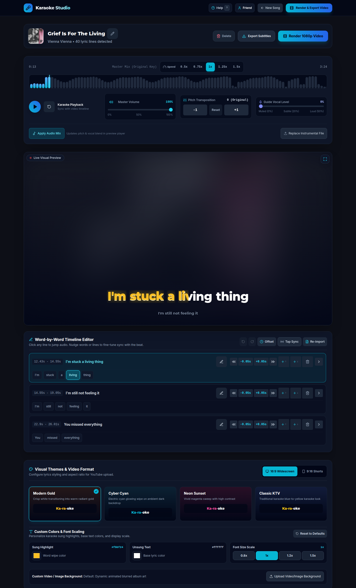

# Karaoke Studio

Local-first audio workstation for stem separation, acoustic word alignment, timeline lyric synchronization, and 1080p lyric video rendering.



## Features

- **Audio intake**: upload local tracks (`.mp3`, `.wav`, `.flac`) or ingest audio streams via `yt-dlp`.
- **Project library search, filter, sort & lifecycle**: instant client-side search (by title, artist, or creator), status filtering (`All`, `Ready`, `In Progress / Error`), sorting (`Recent`, `Title A–Z`, `Artist A–Z`), metadata editing (`title` and `artist`), and project deletion with automatic cancellation of in-flight jobs and full disk cleanup across `downloads/`, `stems/`, and `output/`.
- **Stem separation**: Demucs isolates `vocals.wav` and `instrumental.wav`. Supports direct uploads for official backing tracks.
- **Lyric sync & in-studio hot-swapping**: pulls timecoded lyrics from LRCLIB and `syncedlyrics`, accepts custom text and `.lrc` timestamps, and supports in-studio lyric replacement and acoustic realignment without re-running stem separation.
- **Word alignment**: calculates word-level boundaries using acoustic energy and envelope detection.
- **Timeline editor & power tools**: 50-step Undo/Redo history (`Ctrl+Z` / `Ctrl+Y`), batch timestamp offset shifting (across all lines or from the selected line onward), live Line and Word Tap-to-Sync (`T`) beat stamping during playback, inline lyric text editing, line insertion and deletion with automatic monotonic word-level timing recalculation, interactive waveform scrubbing, ±0.2s line nudging, and dirty-state discard protection.
- **Studio mixing & playback speed**: interactive audio/vocal waveform scrubber, variable playback speed (`0.5x`–`1.5x`) for practicing or fine-tuning sync, semitone pitch shifting (-12 to +12) without tempo change, master volume and mute controls, and 0% to 50% guide vocal blending.
- **Fullscreen TV Stage Mode & custom styling**: Fullscreen stage mode (`F`) with auto-hiding floating playback controls, four visual theme presets (Modern Gold, Cyber Cyan, Neon Sunset, Classic KTV), custom sung/unsung color pickers, adjustable lyric font scaling (`0.75x`–`1.5x`), custom video/image backgrounds, auto-blurred album art, and 16:9 widescreen or 9:16 vertical outputs.
- **Keyboard navigation & in-app help**: transport and studio shortcuts (`Space`, `←`, `→`, `M`, `F`, `T`, `Ctrl+Z`, `Ctrl+Y`) and `?` hotkey for the accessible In-App Help & Studio Usage Guide modal, plus styled contextual tooltips with hotkey badges across studio controls.
- **Export kit, direct audio stems & standalone subtitles**: direct 1-click downloads for isolated audio stems (`instrumental.wav`, `vocals.wav`, and pitch-shifted `master.wav`), instant standalone `.lrc` and `.ass` synchronized subtitle downloads (including custom colors, font scaling, `1920x1080` / `1080x1920` resolution, and progressive `\kf` karaoke tags) without waiting for a video render, plus full 1080p60 MP4 renders with 320 kbps AAC audio and YouTube metadata packages.
- **Resilience & accessibility**: comprehensive error boundaries with audio auto-recovery, in-app toast alerts, and accessible focus traps for modal dialogs.
- **Responsive mobile & tablet studio**: adaptive layouts down to 320px–375px viewports with touch-sized (`>=44px`) transport/mixing/library controls, 2-row mobile lyric timeline nudging, and live 16:9 widescreen / 9:16 vertical Shorts previews.
- **Access control & worker concurrency**: HMAC-SHA256 signed session tokens with `HttpOnly` cookies, sliding-window login rate limiting (`429 Too Many Requests`), and bounded background worker semaphores (`MAX_CONCURRENT_JOBS`) that queue excess pipeline and render jobs without deadlock.

## Keyboard Shortcuts & Studio Controls

The studio provides keyboard shortcuts for playback navigation and precision editing controls. Global shortcuts are isolated and automatically ignored while typing in text inputs or navigating active modal dialogs.

| Shortcut / Control | Type | Description |
| :--- | :--- | :--- |
| <kbd>Space</kbd> | Shortcut | Toggle master audio playback / pause |
| <kbd>←</kbd> (Left Arrow) | Shortcut | Seek backward 5 seconds in timeline playback |
| <kbd>→</kbd> (Right Arrow) | Shortcut | Seek forward 5 seconds in timeline playback |
| <kbd>M</kbd> / <kbd>m</kbd> | Shortcut | Toggle audio mute / unmute |
| <kbd>F</kbd> / <kbd>f</kbd> | Shortcut | Toggle Fullscreen TV Stage Mode with auto-hiding floating controls |
| <kbd>T</kbd> / <kbd>t</kbd> | Shortcut | Stamp current playback timestamp onto target line or word during Tap-to-Sync mode |
| <kbd>Ctrl+Z</kbd> / <kbd>Cmd+Z</kbd> | Shortcut | Undo most recent lyric timeline edit (up to 50 steps) |
| <kbd>Ctrl+Y</kbd> / <kbd>Cmd+Shift+Z</kbd> | Shortcut | Redo previously undone lyric timeline edit |
| <kbd>?</kbd> | Shortcut | Toggle in-app Help & Studio Usage Guide |
| **Waveform Scrubber** | Control | Interactive audio/vocal energy waveform with click-and-drag seeking |
| **Playback Speed** | Control | Variable speed selector (`0.5x`, `0.75x`, `1.0x`, `1.25x`, `1.5x`) synchronized with lyric sweeps |
| **Master Volume** | Control | Linear volume slider (0%–100%) and mute toggle for studio monitoring |
| **Pitch Shift** | Control | Stepper to shift playback pitch from -12 to +12 semitones without altering tempo |
| **Guide Vocal** | Control | Blend slider from 0% to 50% vocal volume over instrumental backing tracks |
| **Batch Offset & Tap-to-Sync** | Control | Shift all or selected-onward lyric timestamps by a custom delta, or tap live with the beat in Line or Word sync mode |
| **In-Studio Lyric Re-Import** | Control | Replace lyrics via custom text/LRC or re-query LRCLIB and realign word timings in-place |
| **Timeline Nudging** | Control | Stepper buttons to shift line start and end timestamps in ±0.2-second increments |
| **Inline Line Editing** | Control | Edit lyric line text, insert lines above/below/end, or delete lines with automatic word-token timing recalculation |
| **Word Sweep & Custom Styling** | Control | Progressive sub-line wipe preview with customizable sung/unsung colors and font scaling (`0.75x`–`1.5x`) |
| **Modal Focus Traps** | Accessibility | Keyboard focus looping (`Tab`, `Shift+Tab`) and `Escape` dismiss for Auth, Metadata, Delete, Export, and Help dialogs |

## Quick Start

### Option 1: Automatic local launch

Run the startup script:

```bash
./run.sh
```

The script verifies FFmpeg, sets up the Python virtual environment, builds the frontend if needed, starts the FastAPI server on port 8000, and opens your browser.

### Option 2: Docker Compose

Start the studio container:

```bash
docker compose up -d
```

To expose the studio via an existing Cloudflare Tunnel, set `CLOUDFLARE_TUNNEL_TOKEN` in your `.env` file and start with the tunnel profile:

```bash
docker compose --profile tunnel up -d
```

### Option 3: Manual development setup

1. Install backend dependencies and start the API:

```bash
python3 -m venv venv
source venv/bin/activate
pip install -r backend/requirements.txt
uvicorn backend.main:app --host 0.0.0.0 --port 8000 --reload
```

2. Start the Vite development server:

```bash
cd frontend
npm install
npm run dev
```

The frontend development server proxies API requests to `http://localhost:8000`.

## Quality Tooling & Verification

Karaoke Studio maintains strict quality gates across both backend and frontend layers.

### Backend Testing and Linters

All backend tests and linters use Python 3.12+ inside the project virtual environment:

```bash
# Run pytest with code coverage (789 unit, integration, E2E, and adversarial tests)
pytest

# Check code formatting with Ruff
ruff format --check backend

# Run Ruff linter checks
ruff check backend

# Auto-format Python source files
ruff format backend

# Auto-fix fixable Ruff linter warnings
ruff check --fix backend
```

Configuration files:
- `pyproject.toml`: Ruff lint/format rules and pytest-cov settings
- `pytest.ini`: pytest test discovery, warning filters, and coverage flags

### Frontend Testing and Linters

Frontend quality tools run from the `frontend/` directory:

```bash
cd frontend

# Run Vitest unit, component, and responsive layout tests (877 tests across 46 test suites)
npm test

# Run Vitest in interactive watch mode
npm run test:watch

# Run ESLint (zero-warning policy enforced)
npm run lint

# Check code formatting with Prettier
npm run format:check

# Auto-format frontend code with Prettier
npm run format

# Run TypeScript type check (tsc) and production bundle build (Vite)
npm run build
```

### Continuous Integration (CI)

A GitHub Actions workflow (`.github/workflows/ci.yml`) runs on every push and pull request targeting `main`. It executes parallel matrix jobs:
- **Backend Quality Gates**: Ubuntu runner, Python 3.12, FFmpeg + libass, `ruff check`, `ruff format --check`, and full `pytest` suite.
- **Frontend Quality Gates**: Ubuntu runner, Node 20, `npm run lint`, `npm run format:check`, `npm test` (Vitest), and `npm run build` (TypeScript + Vite).

## Configuration

Copy `.env.example` to `.env` to customize settings:

```bash
cp .env.example .env
```

| Variable | Default | Purpose |
| :--- | :--- | :--- |
| `PORT` | `8000` | Port for the web interface and FastAPI server |
| `APP_PASSWORD` | *(empty)* | Passphrase required to log in (issues HMAC-SHA256 session tokens & `HttpOnly` cookies). Leave empty for open access. |
| `LOGIN_RATE_LIMIT_MAX_ATTEMPTS` | `5` | Maximum failed login attempts per client IP within the rate-limit window before returning HTTP `429`. |
| `LOGIN_RATE_LIMIT_WINDOW_SECONDS` | `60.0` | Sliding window duration (in seconds) for failed login attempt rate limiting. |
| `MAX_CONCURRENT_JOBS` | `2` | Maximum simultaneous background processing/rendering worker slots before queueing additional jobs. |
| `CLOUDFLARE_TUNNEL_TOKEN` | *(empty)* | Zero Trust tunnel token for routing a custom domain to Docker. |
| `KARAOKE_DATA_DIR` | `./workspace_data` | Directory for downloaded audio, stems, and rendered videos. |

## System Requirements

- **Operating system**: Linux, macOS, or Windows (WSL2 recommended)
- **Python**: 3.10 or higher (Python 3.12 recommended)
- **Node.js**: 18 or higher
- **FFmpeg**: compiled with `libass` support (required for subtitle burning)
- **Disk space**: at least 5 GB free for Demucs model weights and audio workfiles

## Architecture & Engineering Highlights

Karaoke Studio was engineered as a high-concurrency, local-first media workstation:

- **Modular Backend Architecture**: FastAPI backend decomposed into single-responsibility routers (`routers/auth`, `routers/projects`, `routers/uploads`, `routers/exports`) and service layers (`services/separator`, `services/lyrics`, `services/aligner`, `services/audio_mixer`, `services/video_renderer`, `services/ass_generator`), backed by bounded worker semaphores (`MAX_CONCURRENT_JOBS`) and cancelable thread execution.
- **Modular Frontend Architecture**: React 18 single-page application structured into focused subcomponent hierarchies (`components/audio/`, `components/export/`, `components/timeline/`, `components/track-search/`) and custom hooks (`useKeyboardShortcuts`, `useFocusTrap`, `useInterpolatedTime`, `useLyricEditorState`, `useTapCursorHistory`, `useTimelineAutoScroll`).
- **Audio DSP Pipeline**: Demucs v4 (Hybrid Transformer) stem isolation combined with acoustic energy envelope detection to calculate fine-grained syllable and word boundaries.
- **Video Rendering Engine**: Native FFmpeg filtergraphs with `libass` compositing to burn dynamic progressive wipe karaoke styles directly into 1080p60 MP4 with 320 kbps AAC audio.
- **Fault-Tolerant Storage**: Atomic JSON persistence with automated backup recovery to guard against state corruption during sudden shutdowns.
- **Modern Interface**: React 18, Tailwind CSS, Lucide icons, contextual tooltips with hotkey badges, and Wavesurfer.js audio scrubbers for interactive timeline editing.

For a comprehensive architectural guide covering decomposed backend routers, media processing pipelines, frontend state architecture, and test suite organization, see [docs/ARCHITECTURE.md](docs/ARCHITECTURE.md).

### Development & AI Assistance

Code generation, test suites, and refactors were iteratively produced using LLMs under direct engineering oversight. System architecture, product requirements, homelab infrastructure deployment, and real-world failure triage—including FFmpeg stream deadlocks, YouTube rate limits, and pipeline concurrency—were driven, tested, and validated by the maintainer.

## Maintenance & Support

This repository is maintained as an open-source portfolio and personal showcase project. It is provided **"as-is"** without dedicated commercial support or SLAs. Upstream dependencies (such as YouTube stream extractors or external lyric APIs) may require periodic updates if upstream platforms alter their signatures.

## Legal & Fair-Use Disclaimer

Karaoke Studio is intended strictly for personal, educational, and fair-use audio exploration, practice, and amateur karaoke production using locally owned media or authorized streams. The authors do not encourage or condone copyright infringement. Users are solely responsible for ensuring compliance with all applicable copyright laws and third-party terms of service.

## License

This project is licensed under the [GNU Affero General Public License v3.0 (AGPL-3.0)](LICENSE). Any derivative network services or distributions must provide corresponding source code under the same license terms.
