# Karaoke Studio

Local-first web app that turns any song into karaoke: it splits the vocals from the backing track, times the lyrics down to the word, lets you fix anything on a live timeline, and exports 1080p karaoke videos.


## What's new in 2.1

- **Balanced and Best on a cloud GPU.** On a slow server, the RoFormer presets can run on a [Modal](https://modal.com) GPU instead: about a minute for a 4-minute song on Balanced. Fast always runs on your server, and songs fall back to it when the cloud is unavailable.
- **Real 60 fps exports.** The lyric sweep is drawn for every frame (still and colour backgrounds used to run at 25 fps), exports are faster on your own server, and they can render on a Modal cloud CPU instead.
- **Fixes.** Balanced and Best no longer fall back to Fast in images built with librosa 1.0, and a newly opened song shows its key from the first frame.

## What's new in 2.0

- **A redesigned studio.** One screen: stage and timeline in the middle, the mix and look inspector on the right, a transport dock at the bottom. Built on a token-driven design system with a new default theme, **Afterglow**. The four classic themes are still there.
- **Cleaner stems.** Choose **Fast**, **Balanced** or **Best** separation per song. Balanced (Mel-Band RoFormer) is the new default and falls back to Fast automatically. You can re-make a finished song's stems at another quality later, in the background.
- **Better lyric sync.** A neural word aligner (Meta's MMS model) runs when available, with the DSP aligner as fallback. Every line gets a confidence score, shaky lines show up under **Needs review**, and any line can be re-aligned on its own.
- **Exports match the stage.** The live preview uses the same backdrop, duet colours and font as the rendered video, and exported subtitles no longer run ahead of the singing.
- **Power-user polish.** A command palette (<kbd>Ctrl</kbd>/<kbd>⌘</kbd>+<kbd>K</kbd>), media keys, stage settings that persist, and more keyboard shortcuts.

## Screenshots

| | |
| :---: | :---: |
| 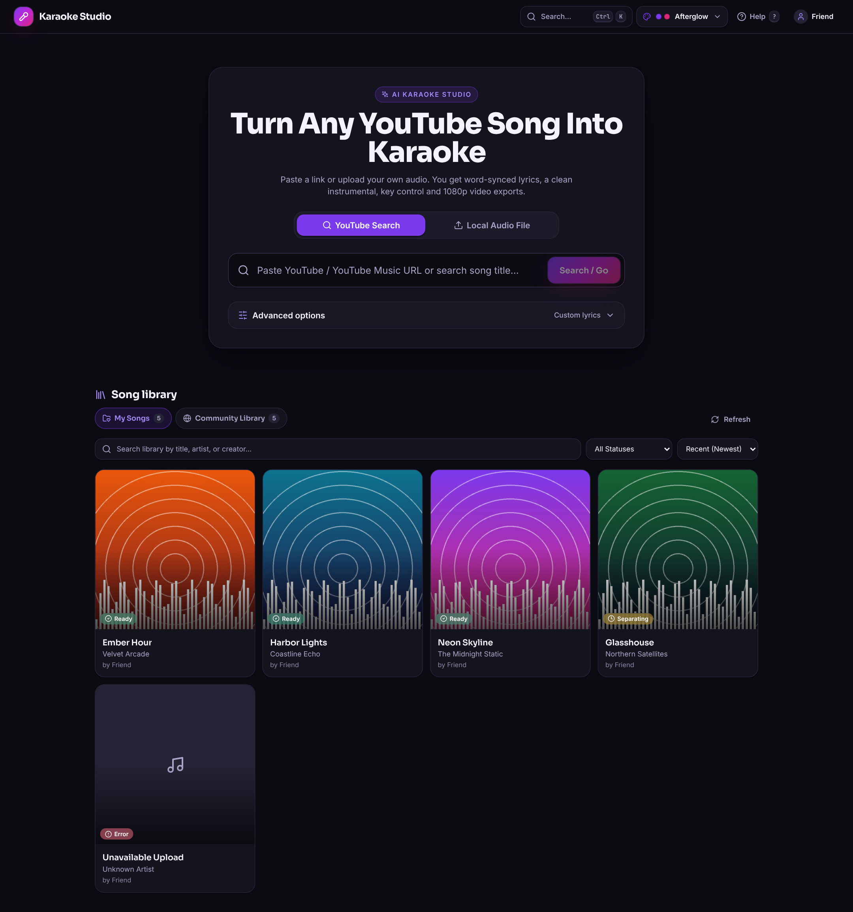 <br> Library and intake | 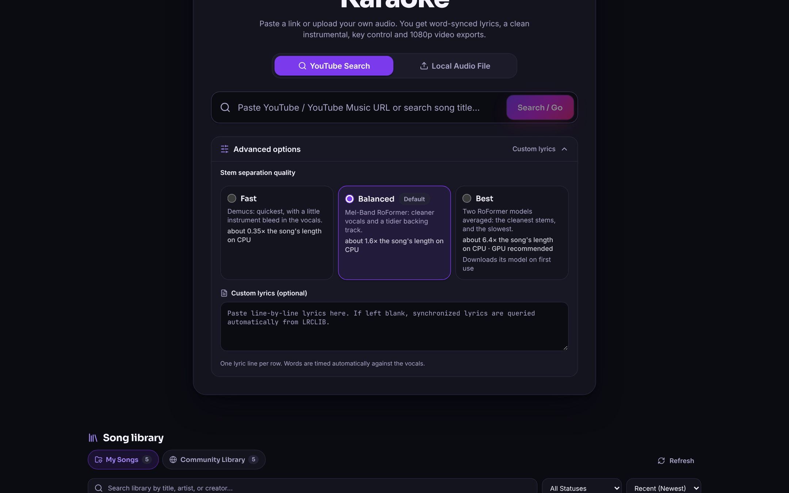 <br> Stem quality at intake |
| 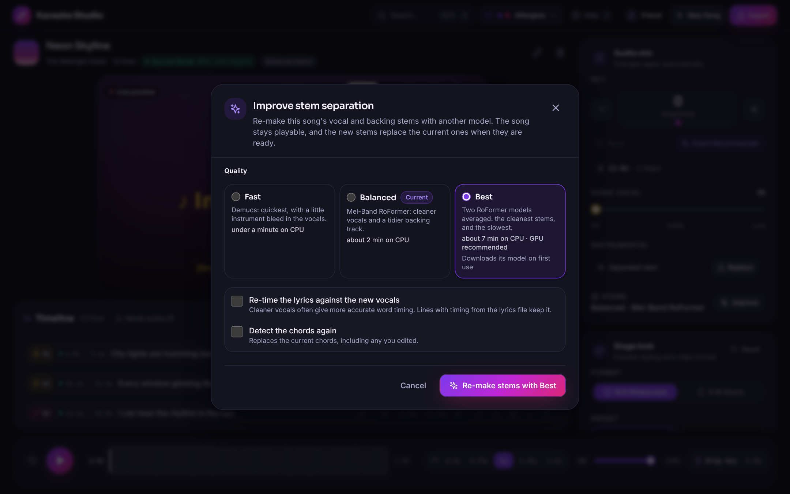 <br> Re-make stems at another quality | 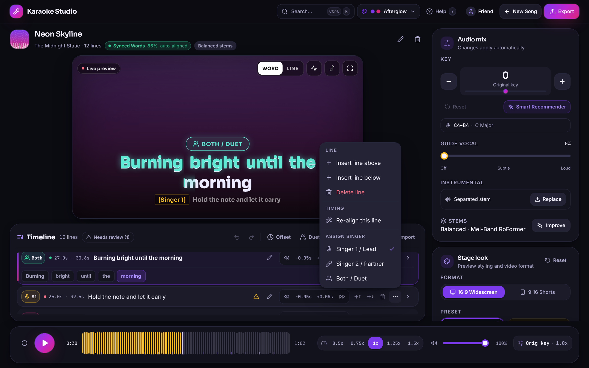 <br> Re-align one line |
| 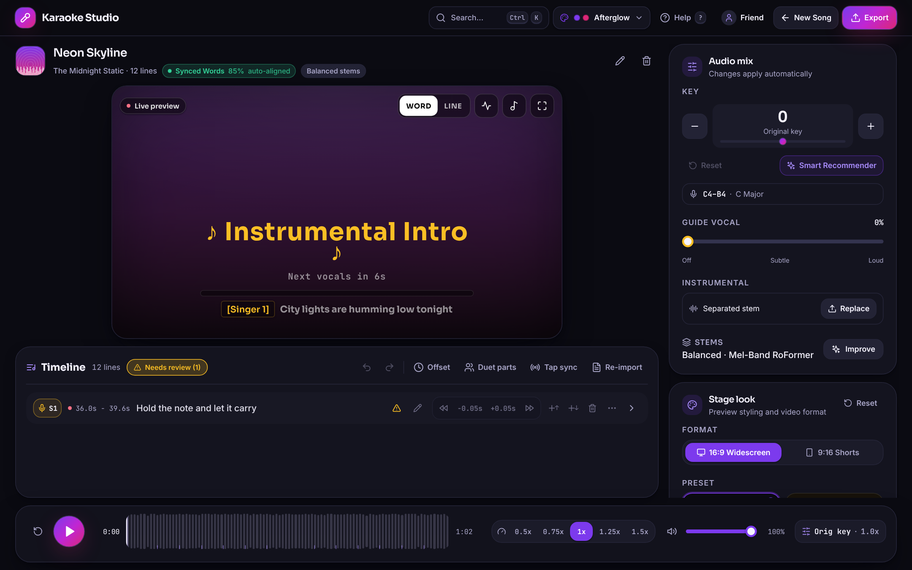 <br> Needs review | 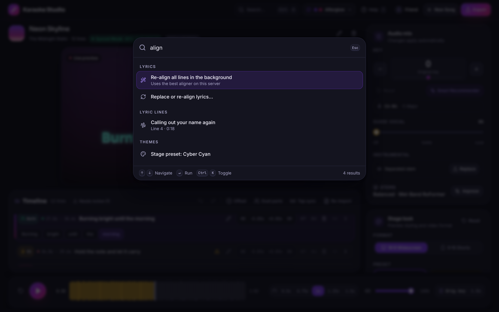 <br> Command palette |
| 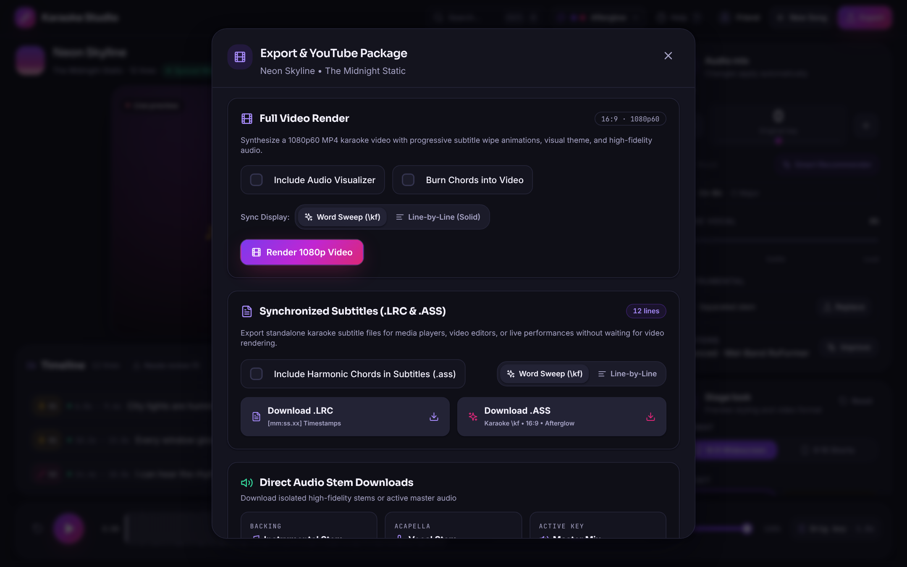 <br> Export | 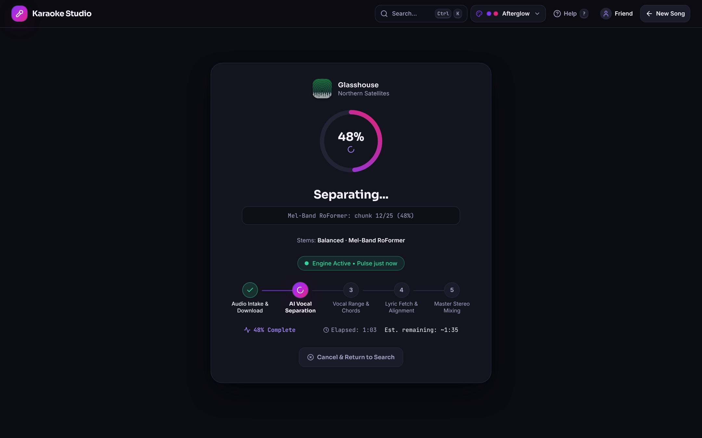 <br> Processing |
| 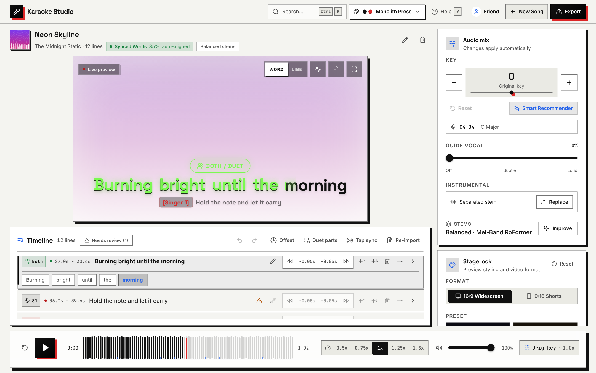 <br> Monolith Press theme | 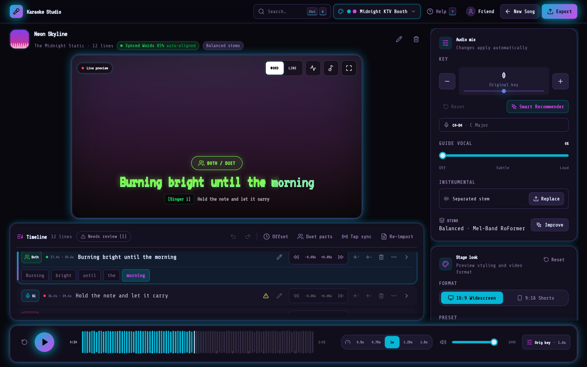 <br> Midnight KTV Booth theme |
| 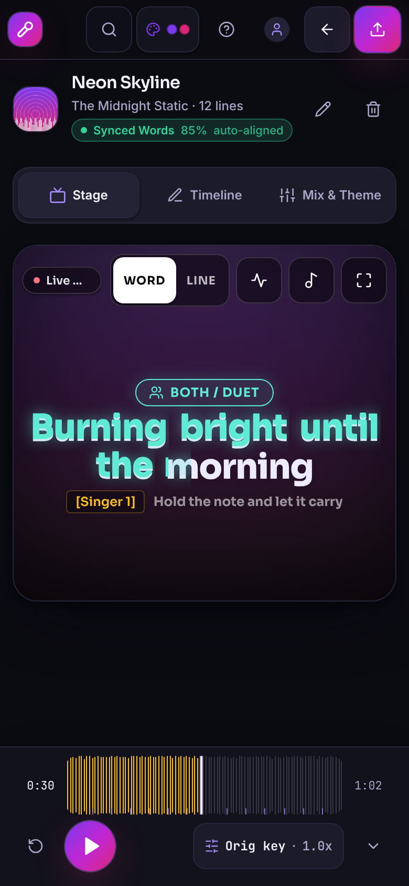 <br> Phone: stage | 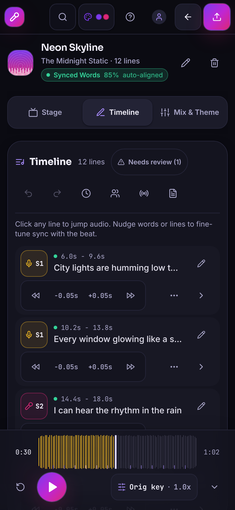 <br> Phone: timeline |

## Features

### Stem separation

Pull audio from YouTube (`yt-dlp`) or upload `.mp3`, `.wav`, `.flac`, `.m4a`, `.ogg`, `.opus` or `.aac`. The song is split into `vocals.wav` and `instrumental.wav` at the quality you pick in **Advanced options**:

| Preset | Engine | Time on CPU (4-min song) | Notes |
| :--- | :--- | :--- | :--- |
| **Fast** | Demucs `htdemucs` | about 1.5 min | Bundled. Some instrument bleed in the vocals. |
| **Balanced** *(default)* | Mel-Band RoFormer | about 6 min | Cleaner vocals, tidier backing track. Needs the ML extras. |
| **Best** | Mel-Band RoFormer + BS-RoFormer, averaged | about 25 min | Cleanest. A GPU is recommended. |

When a preset cannot run (extras not installed, weights unavailable, out of memory), separation falls back Best → Balanced → Fast and the studio says why. The Mix panel shows which model made a song's stems, and **Improve** re-makes them at another quality while the song stays playable. You can also re-time the lyrics against the new vocals or detect the chords again.

**Cloud GPU (optional).** On a slow CPU, Balanced and Best can run on a [Modal](https://modal.com) GPU instead: deploy `gpu/modal_app.py` once with `modal deploy gpu/modal_app.py`, then set `SEPARATION_REMOTE=modal` and a Modal token in `.env`. The GPU runs the same RoFormer worker, progress streams back to the studio, and a 4-minute song takes about a minute on Balanced and two on Best, billed per second. If the GPU service is unreachable or no GPU is free within `SEPARATION_REMOTE_QUEUE_SEC`, the song falls back to Fast on your server.

### Lyrics and sync

- Lyrics come from LRCLIB and `syncedlyrics`, or you paste plain text or LRC (enhanced LRC word tags are kept).
- **Neural alignment** (MMS forced alignment through torchaudio) places each word when the model is available. The **DSP aligner** (vocal energy, spectral flux and phrase snapping) is the fallback and the in-request engine.
- Every line gets a **confidence** score from how well the vocal stem supports its timing. The sync badge shows the song's average, a dot on each timeline row shows the line's, and **Needs review** filters the lines below 60%.
- **Re-align this line** (row menu) finds where a line is really sung near its current place and applies the result as an undoable edit. Whole songs can be re-aligned in the background with the neural aligner while you keep working.
- Lines you change by hand are marked as manual and keep your timing.

### Timeline editor

50-step undo and redo, live tap-to-sync (<kbd>T</kbd>), batch offsets, ±0.2 s and ±0.05 s nudges, an expandable per-word editor, inline text and chord editing, and duet parts (Singer 1, Singer 2, Both).

### Stage, themes and export

- Word-sweep or line-by-line highlighting, instrumental countdowns, a beat visualizer (<kbd>V</kbd>), a transposing chord bar (<kbd>C</kbd>) and a fullscreen TV stage (<kbd>F</kbd>).
- Five app themes (**Afterglow**, **Basement Flyer**, **Reel-to-Reel '74**, **Midnight KTV Booth**, **Monolith Press**) and nine stage presets, with custom colours and font scale. Stage settings are remembered.
- Backgrounds: the song's **cover art**, still or **drifting** in a slow pan, **aurora** (soft orbs in the preset's colours), a **spectrum** that rises with the music, a **plain** colour, or your own image or looping video. The stage draws each one the way the video does: cover art is the export's own image, and moving backgrounds follow the song, so a paused stage shows the video's frame at that moment.
- Key shift (−12 to +12 semitones) and speed (0.5× to 1.5×), a 0–50% guide vocal, and the **Smart Key Recommender** that fits a song's vocal range to your voice. Final renders shift pitch with Rubber Band at high quality, keeping the guide vocal's formants.
- Exports: 1080p60 MP4 (16:9 or 9:16 Shorts) with the lyric sweep drawn for every frame, `.lrc` and `.ass` subtitles, WAV stems, chord and lyric sheets, and a YouTube metadata kit. **Render Again** makes a new video after you change the lyrics, key or look, and **Try Again** retries a failed render.
- **Cloud export (optional).** With `RENDER_REMOTE=modal` (same Modal deployment and token as the cloud GPU), MP4s render on a 16-core Modal CPU: about 1¼ minutes for a 3-minute song, around a cent each. Opening the Export dialog starts a cloud CPU in the background, so Modal finds one while you choose the options, and it stays ready for 2 minutes after each export. While the export waits for a CPU, the studio counts the seconds. If it is unavailable or fails, the export renders on your server.

## Quick start

### One-command local launch

```bash
./run.sh
```

Checks FFmpeg, creates the Python environment, installs dependencies (CPU PyTorch by default), builds the frontend if needed, starts the server on port `8000` and opens your browser. Set `INSTALL_ML_EXTRAS=1` to also install the RoFormer extras for Balanced and Best, and `TORCH_INDEX_URL` to pick another PyTorch build (for example CUDA):

```bash
INSTALL_ML_EXTRAS=1 ./run.sh
```

### Docker Compose

```bash
docker compose up -d
```

The image includes the ML extras (build with `--build-arg INSTALL_ML_EXTRAS=0` for a smaller, Fast-only image). Model weights live in the `karaoke-models` volume, so they download once and survive rebuilds. To expose the app through a Cloudflare Tunnel, set `CLOUDFLARE_TUNNEL_TOKEN` in `.env` and run:

```bash
docker compose --profile tunnel up -d
```

### Manual development setup

```bash
# Backend (port 8000)
python3 -m venv venv
source venv/bin/activate
pip install --extra-index-url https://download.pytorch.org/whl/cpu -r backend/requirements.txt
pip install --extra-index-url https://download.pytorch.org/whl/cpu -r backend/requirements-ml.txt  # optional
uvicorn backend.main:app --host 0.0.0.0 --port 8000 --reload

# Frontend (proxies API requests to localhost:8000)
cd frontend
npm install
npm run dev
```

## Models and licences

Nothing is downloaded until it is first needed. Downloads go to persistent model folders (Docker: the `/models` volume).

| Model | Used for | Size | Licence | Folder |
| :--- | :--- | :--- | :--- | :--- |
| Demucs `htdemucs` | Fast | about 80 MB | MIT | `TORCH_HOME` |
| Mel-Band RoFormer | Balanced, Best | about 0.9 GB | third-party, see the model card | `AUDIO_SEPARATOR_MODEL_DIR` |
| BS-RoFormer | Best | about 0.6 GB | third-party, see the model card | `AUDIO_SEPARATOR_MODEL_DIR` |
| MMS forced aligner | neural lyric alignment | about 1.2 GB | **CC-BY-NC 4.0 (non-commercial)** | `ALIGNMENT_MODEL_DIR` |

- Review the model licences before any commercial use. The MMS aligner is for non-commercial use only. Set `ALIGNMENT_ENGINE=dsp` to never use it.
- To prefetch everything (for example while building an image, or for an offline server), run:

  ```bash
  python -m backend.tools.fetch_models --separation all --alignment
  ```

  Then set `SEPARATION_ALLOW_DOWNLOAD=0` and `ALIGNMENT_ALLOW_DOWNLOAD=0` so the server never downloads at run time.
- `GET /api/capabilities` reports what the server can run right now and why not; the intake picker and the re-align dialogs use it.

## Keyboard shortcuts

Shortcuts are ignored while you type in a field or while a dialog is open.

| Key | Action |
| :--- | :--- |
| <kbd>Space</kbd> | Play / pause |
| <kbd>←</kbd> / <kbd>→</kbd> | Seek 5 seconds |
| <kbd>Shift</kbd>+<kbd>←</kbd> / <kbd>→</kbd> | Seek 1 second |
| <kbd>Alt</kbd>+<kbd>←</kbd> / <kbd>→</kbd> | Seek 15 seconds |
| <kbd>[</kbd> / <kbd>]</kbd> | Previous / next lyric line |
| <kbd>R</kbd> | Replay the current line |
| <kbd>M</kbd> | Mute / unmute |
| <kbd>F</kbd> | Fullscreen stage |
| <kbd>V</kbd> | Beat visualizer |
| <kbd>C</kbd> | Chord bar |
| <kbd>T</kbd> | Tap-to-sync stamp |
| <kbd>Ctrl</kbd>/<kbd>⌘</kbd>+<kbd>Z</kbd>, <kbd>Ctrl</kbd>/<kbd>⌘</kbd>+<kbd>Y</kbd> | Undo / redo lyric or chord edits |
| <kbd>Ctrl</kbd>/<kbd>⌘</kbd>+<kbd>K</kbd> | Command palette: every action, song and lyric line |
| <kbd>?</kbd> | Help and usage guide |
| Media keys | Play, pause, previous / next line, seek (MediaSession) |

## Configuration

Copy `.env.example` to `.env`; it documents every setting.

```bash
cp .env.example .env
```

| Variable | Default | Purpose |
| :--- | :--- | :--- |
| `PORT` | `8000` | Port for the web UI and API |
| `APP_PASSWORD` | *(empty)* | Optional shared passphrase (`HttpOnly` cookie session). Leave blank for open local access. |
| `LOGIN_RATE_LIMIT_MAX_ATTEMPTS` / `LOGIN_RATE_LIMIT_WINDOW_SECONDS` | `5` / `60.0` | Failed logins allowed per IP and window before HTTP `429` |
| `MAX_CONCURRENT_JOBS` | `2` | Separations, re-separations, re-alignments and renders running at once |
| `KARAOKE_DATA_DIR` | `./workspace_data` | Audio, stems, renders and `projects.json` |
| `CLOUDFLARE_TUNNEL_TOKEN` | *(empty)* | Cloudflare tunnel token (Docker `--profile tunnel`) |
| `LOG_LEVEL` | `INFO` | Level of the app's own log lines |

**Stem separation**

| Variable | Default | Purpose |
| :--- | :--- | :--- |
| `SEPARATION_QUALITY` | `balanced` | Default preset for new songs: `fast`, `balanced` or `best` |
| `SEPARATION_ALLOW_DOWNLOAD` | `1` | Download RoFormer weights on first use |
| `AUDIO_SEPARATOR_MODEL_DIR` | `<data dir>/models/audio-separator` | Where RoFormer weights live |
| `SEPARATION_BALANCED_MODEL` / `SEPARATION_BEST_MODELS` | built-in | Override the RoFormer checkpoints |
| `SEPARATION_TIMEOUT_SEC` / `SEPARATION_STALL_SEC` | `7200` / `900` | Stop a separation that runs too long or prints nothing |
| `INSTALL_ML_EXTRAS` | Docker `1`, `run.sh` `0` | Install the RoFormer extras |
| `SEPARATION_REMOTE` | *(empty)* | `modal` runs Balanced and Best on a Modal GPU (deploy `gpu/modal_app.py` first) |
| `MODAL_TOKEN_ID` / `MODAL_TOKEN_SECRET` | *(empty)* | Modal token for the server |
| `SEPARATION_REMOTE_APP` | `karaoke-studio-gpu` | Name of the deployed Modal app |
| `SEPARATION_REMOTE_QUEUE_SEC` | `300` | Longest wait for a free GPU before falling back to Fast here |

**Video export**

| Variable | Default | Purpose |
| :--- | :--- | :--- |
| `FFMPEG_PRESET` | `veryfast` | libx264 preset for MP4 exports (slower presets make smaller files) |
| `RENDER_REMOTE` | *(empty)* | `modal` renders exports on a Modal cloud CPU (deploy `gpu/modal_app.py` first) |
| `RENDER_REMOTE_QUEUE_SEC` | `120` | Longest wait for a cloud CPU before rendering here |
| `RENDER_REMOTE_TIMEOUT_SEC` | `3600` | Stop a cloud render that runs longer than this |
| `RENDER_REMOTE_PREWARM` | `1` | Start a cloud CPU when the Export dialog opens (at most once a minute) |
| `RENDER_REMOTE_SCALEDOWN_SEC` | `120` | How long an idle render container waits for the next export (read by `modal deploy`) |

**Lyric sync**

| Variable | Default | Purpose |
| :--- | :--- | :--- |
| `ALIGNMENT_ENGINE` | `auto` | `auto` / `ctc` use the neural aligner when available, `dsp` never does |
| `ALIGNMENT_ALLOW_DOWNLOAD` | `1` | Download the MMS model on first use |
| `ALIGNMENT_MODEL_DIR` | `<data dir>/models/mms_fa` | Where the MMS model lives |
| `ALIGNMENT_MIN_CONFIDENCE` | `0.45` | Model score from which neural word timing replaces the DSP estimate |
| `ALIGNMENT_TIMEOUT_SEC` / `ALIGNMENT_STALL_SEC` | `1800` / `600` | Stop a neural pass that runs too long or prints nothing |
| `MAX_CONCURRENT_ALIGN_JOBS` | `1` | Neural passes at once (each loads the model) |
| `ALIGN_REFINE_PLAIN` | `1` | Snap pasted, untimed lyrics to the sung phrases |

## Tools

```bash
# Download model weights ahead of time
python -m backend.tools.fetch_models --separation all --alignment

# Measure lyric sync accuracy against hand-timed words (enhanced LRC or studio JSON)
python -m backend.tools.benchmark_sync --vocals vocals.wav --truth truth.lrc --engine both

# Measure stem quality (SI-SDR) per preset against reference stems
python -m backend.tools.benchmark_separation --mix song.wav --vocals ref_vocals.wav

# Seed a demo workspace with synthetic songs for UI work and screenshots
KARAOKE_DATA_DIR=/tmp/karaoke-demo python -m backend.tools.seed_demo
```

## System requirements

- **OS**: Linux, macOS, or Windows (WSL2)
- **Python**: 3.10+ (3.12 recommended)
- **Node.js**: 18+
- **FFmpeg**: with `libass` (subtitle burn-in) and ideally `rubberband` (high-quality pitch shifting in renders)
- **Disk space**: about 4 GB for dependencies and model weights, plus room for your songs
- **GPU**: optional. Best separation and neural alignment are much faster on one.

## Development and tests

```bash
# Backend tests and linter (the suite sets its own test passphrase)
pytest
ruff check backend && ruff format --check backend

# Frontend tests, linter, type check and production build
cd frontend
npm test && npm run lint && npm run format:check && npx tsc -p . --noEmit && npm run build
```

Engines that need model weights are tested with fake worker processes, so the suites run offline. For the design system, routes, background jobs and worker protocols, see [docs/ARCHITECTURE.md](docs/ARCHITECTURE.md).

## Licence and disclaimer

For personal, educational and fair-use practice with media you own or have permission to use. Provided as-is under the [GNU Affero General Public License v3.0 (AGPL-3.0)](LICENSE). Model weights downloaded at run time keep their own licences (see above).
